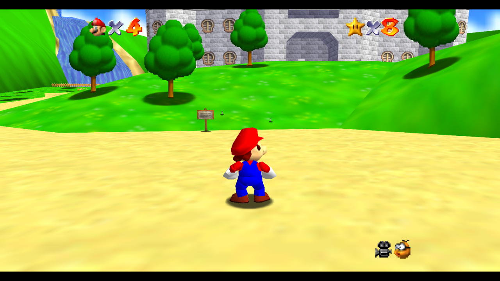
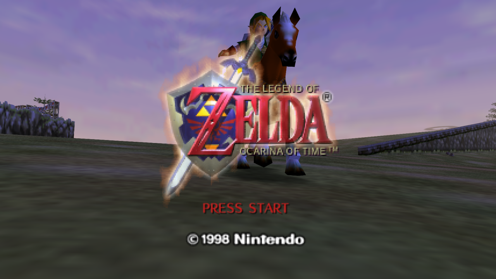
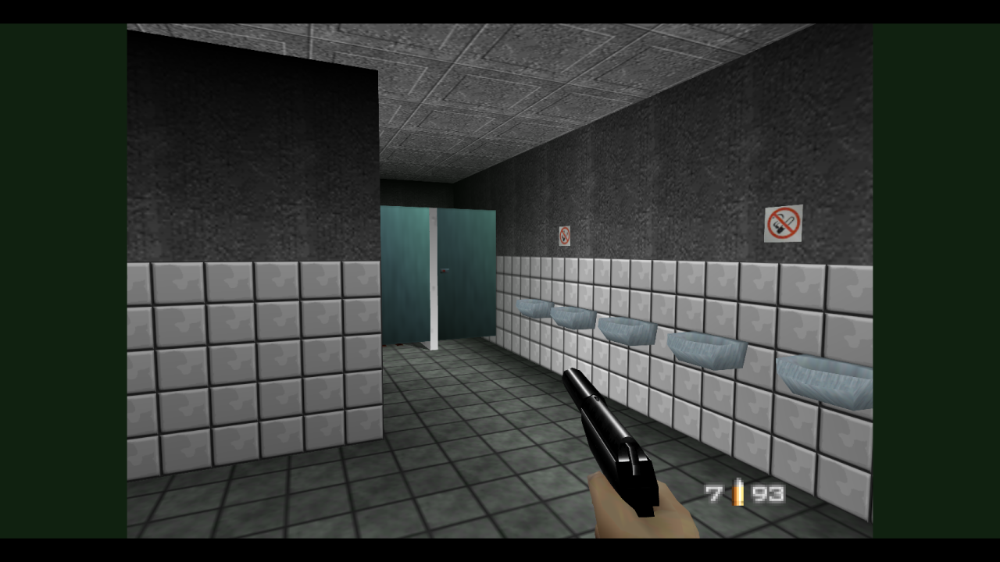
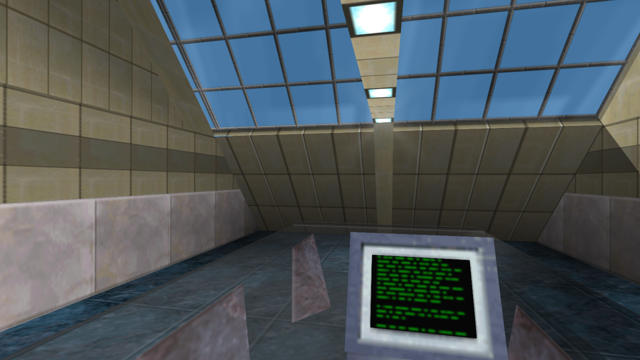
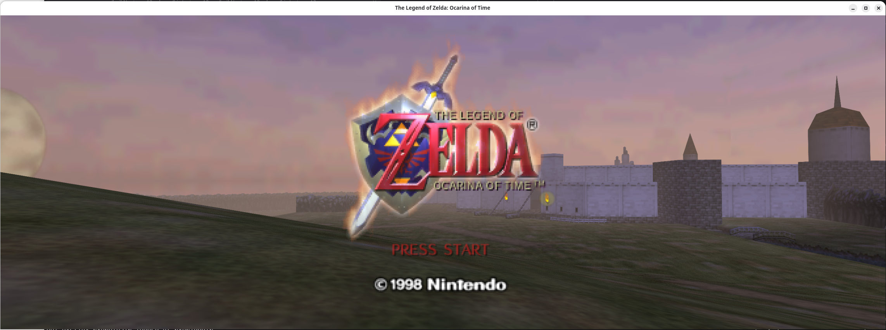

# v64recomp

Native N64 recompilation for Linux. ROM instructions are translated to C and
compiled for the host; shared native services supply scheduling, input, saves,
audio, and RT64 Vulkan graphics. See [how it works](docs/recompilation.md).

## Screenshots

Captured from the native builds.

| Super Mario 64 | The Legend of Zelda: Ocarina of Time | GoldenEye 007 | Perfect Dark |
| --- | --- | --- | --- |
|  |  |  |  |

RT64's widescreen expansion gives *Ocarina of Time* an ultrawide view of Hyrule.



## Build and play

Requirements: Python 3.11+, C/C++ compiler, CMake 3.20+, Ninja, OpenSSL 3, SDL2,
X11/Xwayland, Vulkan, and the populated RT64 checkout in `third_party/rt64/`.
Python generates CPU sources during the build. Built games launch directly.

For Steam Deck, use the [container build and portable package](docs/steamdeck.md)
to compile against glibc 2.36 instead of your host distribution's newer libraries:

```sh
./tools/build_steamdeck.sh oot-us-v12 4
```

CMake prefers Clang (`clang`/`clang++`), falling back to GCC (`gcc`/`g++`) when
the corresponding Clang compiler is unavailable. Explicit `CC`/`CXX`,
`CMAKE_C_COMPILER`/`CMAKE_CXX_COMPILER`, and toolchain selections take precedence.
Existing build directories keep their cached compiler; use a new build directory
to apply the default to a previously configured build.

Clone with submodules to download the pinned RT64 revision and its dependencies,
including Plume:

```sh
git clone --recurse-submodules https://github.com/polaco1782/v64recomp.git
cd v64recomp
```

For an existing checkout, run this from the repository root:

```sh
git submodule update --init --recursive
```

CMake builds these sources locally; it does not clone or initialize submodules.

Run these commands from the checkout root to install the build tools:

```sh
python3 -m venv .venv
.venv/bin/python -m pip install -r requirements.txt
```

Provide your own ROM files and import each game once with
[`tools/import_rom.py`](tools/import_rom.py). The tool accepts big-endian
(`.z64`), byte-swapped (`.v64`) and word-swapped (`.n64`) ROMs. It normalizes the
bytes, verifies the selected profile's exact ROM size and SHA-1, then copies the
result into `local/` with the required filename. It rejects a mismatched ROM or
an existing destination containing different bytes.

```sh
# Super Mario 64 US
.venv/bin/python tools/import_rom.py \
  --profile games/sm64-us/profile.toml --rom '/path/to/Super Mario 64.v64'

# Ocarina of Time US V1.2
.venv/bin/python tools/import_rom.py \
  --profile games/oot-us-v12/profile.toml --rom '/path/to/Ocarina of Time.n64'
```

Every game uses `games/<game>/profile.toml`, where `<game>` is `sm64-us`,
`goldeneye-us`, `shadowman-us`,
`quake-us`, `duke-us`, `duke-zero-hour-us`, `hexen-us`, `nightmare-us`, `oot-us-v12`, `perfectdark-us-v11`, or
`conker-us` (experimental; see its [port status](games/conker-us/README.md)).
The imported, normalized files have these filenames and MD5 checksums:

| Filename | MD5 |
| --- | --- |
| `duke-zero-hour.us.z64` | `026789d47db5fe202a76f89797b33ac7` |
| `duke.us.z64` | `c7f1a43764a26da2e43f2a36a5f76e4c` |
| `conker.us.z64` | `00e2920665f2329b95797a7eaabc2390` |
| `goldeneye.us.z64` | `22ff6c18eb028792ef350554b1e1fa68` |
| `hexen.us.z64` | `eb98f1b8c6898af7417f6882946da9b3` |
| `nightmare.us.z64` | `4116cf435db315a2481af8d1e9352feb` |
| `oot.us.v12.z64` | `57a9719ad547c516342e1a15d5c28c3d` |
| `perfectdark.us.v11.z64` | `e03b088b6ac9e0080440efed07c1e40f` |
| `quake.us.z64` | `097605021951024c3ecb2d502c0c2a9f` |
| `shadowman.us.z64` | `b457298b87b85bbf950f24867daa9475` |
| `sm64.us.z64` | `20b854b239203baf6c961b850a4a51a2` |

After importing a ROM, build and run its game:

```sh
cmake --preset sm64-us-release
cmake --build --preset sm64-us-release -j 4
cmake --build --preset sm64-us-release --target run
# Or launch the executable directly, from any working directory:
./build/sm64-us-release/bin/sm64-us
```

To pack the final executable, install [UPX](https://upx.github.io/) and run:

```sh
cmake --build --preset sm64-us-release --target pack -j 4
```

The `pack` target builds the game, then uses `upx --best --ultra-brute` and checks
the packed file with `upx --test`. It writes `bin/packed/sm64-us` in the build
directory and keeps the original executable. These maximum compression settings
can take a long time. Packing is optional and works with every game, including
embedded-ROM builds. If UPX is outside `PATH`, configure with
`-DRECOMP_UPX_EXECUTABLE=/path/to/upx`.

To include the game's ROM content in the executable with verified CPU code
zeroed before embedding:

```sh
cmake --preset sm64-us-release -DRECOMP_EMBED_ROM=ON
cmake --build --preset sm64-us-release -j 4
./build/sm64-us-release/bin/sm64-us
```

The original ROM is required to build, but embedded builds launch without an
external ROM. `--rom PATH` still loads and verifies an original ROM for comparison.
`-DRECOMP_EMBED_ROM=OFF` restores external-ROM builds (the default).
See [ROM content packaging](docs/rom-packaging.md) for supported layouts,
removal reports and the limits of code stripping.

Replace `sm64-us` with `goldeneye-us`, `shadowman-us`, `quake-us`, `duke-us`,
`duke-zero-hour-us`, `hexen-us`, `nightmare-us`, `oot-us-v12`, `perfectdark-us-v11`, or experimental `conker-us`. ROMs, saves, texture packs and crash dumps stay
in ignored `local/`.

The equivalent explicit CMake configuration is:

```sh
cmake -S . -B build/quake-release -G Ninja -DRECOMP_GAME=quake-us -DCMAKE_BUILD_TYPE=Release
cmake --build build/quake-release -j 4
cmake --build build/quake-release --target run
```

CMake selects one game per build tree and regenerates CPU sources when the ROM,
profiles, inventories or generator change. Unchanged generation is cached. Missing
ROMs or generation failures stop configuration explicitly. The generation log is
in the build directory. CPU sources are split into smaller files for parallel
compilation. Use `-DRECOMP_GAME=none -DRECOMP_BUILD_RT64=OFF` to build shared libraries.

RT64, its shaders and bundled libraries build once under `build/shared/rt64/`
and are reused by every game and both game modes. The shared build uses
`RelWithDebInfo` by default; `-DRECOMP_RT64_BUILD_TYPE=Release` selects another
renderer configuration. Compiler, toolchain and relevant flag changes select a
separate cache directory. Source edits rebuild the affected RT64 files.
`-DRECOMP_RT64_JOBS=4` controls its compiler jobs, independently of game build
parallelism. Builds from different game directories serialize access to RT64.
Cleaning a game removes its local library links while retaining the shared cache.

## Release and debug

`games/<game>/` holds `profile.toml`, `generate.py`, headers, audio profiles and
shared game adapters, such as paging, graphics extensions and overlay loading.
Both modes use these adapters and the same checked ROM metadata.
`games/<game>/release/` holds `app.c` and any additional Release-only sources.
Release retains correctness checks and crash reporting. It writes no routine
reports, WAVs, screenshots, RAM captures or call traces during normal play.

`games/<game>/debug/` holds diagnostic applications, replay inputs and inspection
tools. Debug includes full symbols, unoptimized game code, call tracing, captures,
gameplay probes, RT64's F1 inspector and F6 wireframe.
It retains the existing diagnostic startup behavior and checks.
Both modes reuse RT64's optimized `RelWithDebInfo` build by default. Game code,
the shared runtime and native adapters retain their selected configuration flags.

For thread CPU usage and sampled function call stacks, see
[CPU profiling](docs/profiling.md). `tools/profile_execution.py` attaches to a
running game and saves thread counters and optional perf reports under
`build/profiles/`.

```sh
cmake --preset quake-us-debug
cmake --build --preset quake-us-debug -j 4
./build/quake-us-debug/bin/quake-us --frames 300 --capture-every 60
./build/quake-us-debug/bin/quake-us --trace-calls
cmake --build --preset quake-us-debug --target report
```

All executables accept `--help`, `--rom FILE`, `--data DIR`, `--save FILE`,
`--crash-dir DIR`, `--frames N` (0 runs until close), and `--mute`.
Debug additionally supports `--input FILE`, `--wav FILE`, `--audio-trace FILE`,
`--capture-every N`, and `--trace-calls`. Per-game availability is listed in
[the debug workflow](docs/debugging.md). For the CMake run target, pass arguments
with `-DRECOMP_RUN_ARGS='--frames;300;--mute'` at configuration.

VS Code's **Debug: <game>** configurations configure/build the debug preset and
launch the native executable. Breakpoints work in game adapters, the shared
runtime, backends and `build/<game>-debug/generated/<game>/cpu-*.c`. Persistent
translation fixes belong in the generator or checked metadata.

## Controls and data

Arrow keys move the stick; A/X/Z are N64 A/B/Z; S is Start; C/V are L/R;
I/J/K/L are C buttons. Escape or window close exits. F5 reloads texture packs
and toggles original/replacement textures. Packs default to
`local/textures/<game>/replacements`; `RECOMP_TEXTURE_REPLACEMENTS` overrides this
path (an empty value disables packs). Rendering uses 4x resolution, 4x MSAA,
widescreen expansion and texture LOD scaling. This RT64 revision has no game
ray-tracing renderer.

Use `--texture-scan /path/to/pack.zip` (or an extracted directory) to match
Rice/GLideN64 PNGs while playing. A native worker builds `textures.rtz` and
`rt64.json` in the game's replacement folder every 60 seconds when matches change,
then requests an RT64 reload. Original ZIPs and source images are kept. See
[native texture scanning](texture_scan/README.md) for usage.

Failures in either mode routed through `recomp_fail` write a uniquely named JSON report
and RDRAM snapshot to `local/crashes/<game>/`. Reports include native stack
addresses, guest thread registers/last tracked PCs and the latest task. Keep the
executable and its generated sources when investigating a crash:

```sh
.venv/bin/python tools/inspect_crash.py
```

Host faults outside these controlled checks require GDB or a host core dump.
Save paths preserve the existing SM64/GoldenEye EEPROM and OOT SRAM locations.
Game support remains at the milestones in [status](docs/status.md); selecting
Release does not establish full-game correctness for partial ports.

## Technical information: how it works

The build verifies a game ROM, discovers functions using checked profiles and
inventories, translates MIPS instructions into C11, and compiles the generated
code into a native executable. Game logic runs as compiled host code while the
ROM supplies its original assets and data.

The shared runtime implements the OS and device behavior the game expects:
thread scheduling, message queues, timers, input, saves and task completion.
Verified OS/library routines call native handlers. RT64 renders graphics tasks;
the native audio backend processes supported sound tasks and sends PCM to SDL.

The technical documentation covers each part:

- [Complete process flow](docs/process-flow.md): graphs covering ROM import, generation, compilation, packaging, runtime services, workers and failure investigation.
- [Recompilation pipeline](docs/recompilation.md): ROM mappings, discovery, translation and native execution.
- [Adding a ROM](docs/adding-a-rom.md): step-by-step porting, required tools, missing symbols and crash investigation.
- [MIPS code expansion and native efficiency](docs/code-expansion.md): measured size ratios, a MIPS → C → x86-64 example and compiler optimizations.
- [OS emulation and native calls](docs/os-emulation.md): why OS support is needed, which calls are replaced and how guest behavior is preserved.
- [Native hook recognition](docs/native-hooks.md): ROM fingerprints, game-specific overrides and guarded direct calls.
- [Thread scheduling and workers](docs/threading.md): priorities, blocking, message delivery and asynchronous graphics/audio work.
- [Audio processing](docs/audio.md): native DSP tasks, AI timing and SDL playback.
- [Floating-point semantics](docs/fpu.md): guest rounding, exceptions and host arithmetic.

## Layout

- `games/<game>/`: shared headers, adapters, `generate.py` and `profile.toml`.
- `games/<game>/release/`: playable app and Release-only sources.
- `games/<game>/debug/`: trace apps, captures/replays and inspection tools.
- `games/<game>/*.json`: checked ROM inventories and game-specific metadata.
- `runtime/`, `include/`, `backends/`: shared runtime and rendering/audio services.
- `cmake/`, `CMakePresets.json`: game selection, generation, build and run integration.
- `tools/`: shared ROM import, discovery, translation and crash inspection tools.
- `third_party/`: RT64 and the audio DSP dependency.
- `local/`: private ROMs, saves, packs, renderer data and crash dumps.
- `build/`: disposable generated sources, binaries and debug output.
- `build/shared/rt64/`: reusable RT64 builds, grouped by compiler and configuration.

See [audio](docs/audio.md), [floating point](docs/fpu.md),
[threading](docs/threading.md), [native hooks](docs/native-hooks.md),
[debugging](docs/debugging.md), and [textures](docs/textures.md).

## Legal and third-party software

v64recomp is licensed under the **GNU General Public License, version 2**
(`GPL-2.0-only`); see [LICENSE](LICENSE). Third-party components retain their
original licenses and notices; see [THIRD_PARTY_NOTICES.md](THIRD_PARTY_NOTICES.md).

This repository does not include or distribute ROM images or copyrighted game
assets. Users must provide their own ROM files. The project uses free and
open-source software; each third-party component remains subject to its own
license.

Graphics are provided by [RT64](https://github.com/rt64/rt64), an open-source
N64 graphics renderer used by this project for Vulkan rendering.
