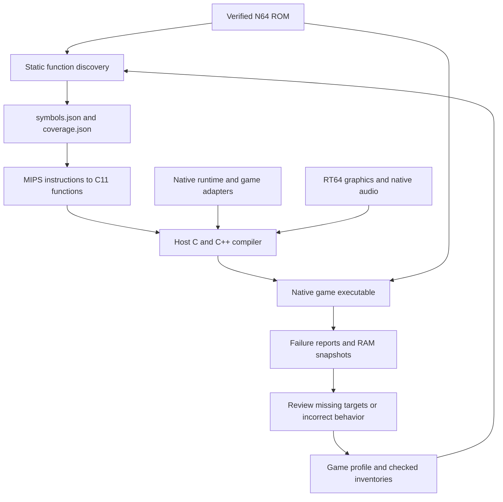

# v64recomp

Native N64 recompilation for Linux. ROM CPU instructions are translated from MIPS
to C11 and compiled for the host. Shared native services supply scheduling, OS,
input, saves and audio; RT64 supplies Vulkan graphics.

Super Mario 64 US is the working gameplay baseline. GoldenEye US reaches the
menus and playable Dam; its CPU inventory and broader gameplay validation remain
in progress. Shadow Man US runs original startup, graphics, audio and its
Controller Pak screen; title/gameplay work remains in progress.
Quake 64 US reaches the main menu and playable first level with movement and
shotgun firing; full-game validation remains in progress. Duke Nukem 64 US
reaches its menus and first level with RT64 graphics and ABI1 audio. Nightmare
Creatures US reaches its menus and playable Chelsea with RT64 graphics and ABI1
audio. See
[SM64](games/sm64-us/README.md), [GoldenEye](games/goldeneye-us/README.md),
[Shadow Man](games/shadowman-us/README.md), [Quake 64](games/quake-us/README.md),
[Duke Nukem 64](games/duke-us/README.md),
[Nightmare Creatures](games/nightmare-us/README.md)
and [the roadmap](PLAN.md).

## How recompilation works

The build starts with a verified game ROM. Rabbitizer decodes its MIPS CPU
instructions, the translation tools emit C11 functions, and the host compiler
turns those functions into a native executable. The original game still controls
its logic and reads its assets from the ROM. Shared native services implement
the N64 OS and hardware interactions required by each game.



### 1. Verify the ROM and describe its memory layout

Import accepts the common big-endian, byte-swapped and word-swapped N64 ROM
formats, normalizes the bytes, and verifies the expected size and SHA-1. Profiles
target exact ROM revisions; addresses and instruction fingerprints depend on
those bytes.

A ROM does not provide the ELF section and symbol information needed by the
translator. Each game's TOML profile supplies the relevant mappings from ROM
offsets to N64 virtual addresses, along with startup parameters, known function
roots and any special loading behavior. For example, Duke's profile maps its
initial `.main` region from ROM offset `0x1000` to guest address `0x8004B400`.
Such a mapped region can contain both code and data; mapping it does not classify
every byte as an instruction.

Builds do not require the original game's C source or a matching ELF/map. SM64's
complete inventory was cross-checked against a matching ELF/map during
development, but its build reads the stored inventory and ROM.

### 2. Discover functions without running the game

`tools/discover.py` walks instruction control flow from the ROM entry point,
profile roots and checked function entries. It follows direct calls, discovers
their targets, and explores both possible branch paths unless the instruction
itself proves one impossible. N64 branch delay slots are included in that
analysis. This stage does not need gameplay or a recorded execution trace.

Indirect transfers need additional information. A direct `jal` instruction
encodes its destination, while `jalr` takes a destination from a register.
Computed local jumps can select a target from a switch table. Profiles can supply
checked targets and jump tables, and registered indirect calls can resolve
against the compiled function registry at runtime.

Files such as [Duke's startup-entries.json](games/duke-us/startup-entries.json)
provide checked function starts for partial conversions:

| Field | Purpose |
| --- | --- |
| `format_version` | Identifies the inventory format. |
| `rom_sha1` | Binds the inventory to the exact normalized ROM. |
| `complete` | `false` identifies a partial function-entry inventory. |
| `entries[].vram` | Gives the original N64 address of a function entry. |
| `entries[].origin` | Records how the entry was identified: `direct-jal`, `stack-prologue` or `checked-root`. |
| `entries[].sha256` | Verifies the first 16 bytes at that address before using it. |

These entries seed discovery, including functions that may only be reached as
callbacks. The JSON supplies function starts; the profile supplies memory
regions. The entry fingerprint verifies the instruction prefix, rather than
claiming to describe the function's complete body or size.

Static discovery alone cannot guarantee every function has been found. Unused
code, function pointers, computed addresses and data that decodes as valid MIPS
instructions can leave ambiguities. Discovery reports unresolved transfers,
conflicting instruction ownership and unvisited ranges for review.

A complete inventory, such as
[SM64's code-inventory.json](games/sm64-us/code-inventory.json), additionally
classifies every byte of the configured regions as CPU code, data, native OS
code or RSP code. The tools validate contiguous range coverage and fingerprints,
and retain instructions in CPU code ranges even when the control-flow walk did
not visit them. Constructing that inventory can be done through static analysis
and review without playing the game. A complete inventory still needs separate
runtime validation; neither static coverage nor a gameplay trace proves that
every game scenario behaves correctly.

### 3. Translate MIPS semantics into C

`tools/translate.py` checks discovered functions and writes a coverage report
before emitting `functions.c` and `generated.h`. Unsupported instructions or
unresolved targets in selected ordinary functions prevent generation. Explicit
unsupported boundaries can be emitted as functions that fail if called; partial
conversions report those boundaries rather than implying full game support.

The generated C represents guest registers through `MipsContext`. Arithmetic
helpers preserve MIPS widths and sign extension, memory operations go through
guest address helpers, and branches become C control flow with the required
delay-slot behavior. For example, the instruction `addiu v0, v0, 1` is lowered
to an operation equivalent to:

```c
mips_set(ctx, 2, mips_s32((uint32_t)ctx->gpr[2] + (uint32_t)1));
```

This performs a wrapping 32-bit addition and sign-extends the result into the
64-bit guest register. The host compiler then produces machine code for it.
The game executes those compiled functions; CPU instructions are decoded during
generation rather than fetched and interpreted during play.

Guest addresses remain N64 addresses. The runtime maps them into its RDRAM
buffer, handles supported address aliases and game-specific mappings, and checks
memory access ranges. Floating-point helpers preserve the required guest
rounding and register behavior. See [floating point](docs/fpu.md) for details.

### 4. Connect the compiled game to native services

Generated functions are registered by their original guest addresses.
`recomp_lookup` resolves calls to a registered function in a loaded section;
unknown, unloaded or ambiguous destinations fail explicitly. Verified native
hooks with unique entries can be called directly while retaining section checks.

The [shared native hook catalog](docs/native-hooks.md) recognizes known OS and
library routines by their complete ROM-body fingerprints. These bind to native
implementations for threads, message queues, timers, devices, saves and selected
memory/string operations. Unrecognized ordinary routines keep their translated
CPU code. Game-specific adapters handle custom behavior such as virtual-memory
paging or graphics extensions.

Guest threads run through a coroutine scheduler. Blocking OS operations can
yield a thread and resume another according to the guest scheduler state.
Native services preserve guest memory structures, calling conventions and
completion events expected by the translated game.

Graphics tasks pass to RT64 for Vulkan rendering. The translated game's audio
code builds command lists; the shared native audio backend executes supported,
verified ABI1 tasks to produce PCM in guest RAM. The native AI service supplies
buffer timing and completion events, and SDL plays the samples. These task
backends implement supported graphics/audio behavior rather than translating
RSP microcode through the CPU translator. See [audio](docs/audio.md).

### 5. Record gaps and investigate runtime failures

Discovery, translation and controlled runtime failures produce different
artifacts:

| Artifact | What it records |
| --- | --- |
| `symbols.json` | Mapped sections, discovered functions, instruction addresses, discovery errors and unvisited ranges. |
| `coverage.json` | Function translation status, unsupported instructions/targets, metadata issues and inventory coverage. |
| Crash JSON | The controlled runtime failure and diagnostic state, with fields supplied by the game's app. |
| RDRAM snapshot | Guest memory saved alongside a controlled runtime failure. |

For Duke's rendered startup, the default controlled-failure outputs are
`build/duke-us/rom/startup/boot-report.json.crash.json` and
`build/duke-us/rom/startup/boot-report.json.rdram.bin`. Its crash report includes
the failing address, recent guest calls, thread registers, native call stack
and the latest available SP task. Other games can use different filenames and
include additional state. Thread PCs describe the last tracked location, not
an instruction-by-instruction execution trace.

```sh
# Discover and report Duke's conversion gaps without building or playing.
.venv/bin/python games/duke-us/run_duke.py --report-only

# Inspect a controlled runtime failure from a rendered Duke run.
.venv/bin/python tools/inspect_crash.py \
  build/duke-us/rom/startup/boot-report.json.crash.json
```

The repair workflow is to examine the failing target or operation, verify the
corresponding ROM bytes and control flow, update the checked metadata or native
implementation, regenerate, and validate the affected behavior. Unknown targets
are not automatically appended to the function inventory: a bad pointer also
needs investigation before its address is treated as executable code.

Crash JSON covers failures routed through `recomp_fail`. Host faults outside
those checks require a debugger or core dump. Early input/configuration errors
and compiler failures may only produce terminal output or build logs.

## Setup

Requirements: Python 3.11+, a C/C++ compiler, CMake, Ninja, OpenSSL 3, SDL2, X11
or Xwayland, Vulkan and the populated RT64 checkout in `third_party/rt64/`.
Run commands from this checkout's root:

```sh
python3 -m venv .venv
.venv/bin/python -m pip install -r requirements.txt
# Optional texture tools:
.venv/bin/python -m pip install -r requirements-textures.txt
```

Import each supported ROM once. ROMs, saves and texture packs stay in `local/`.

```sh
.venv/bin/python tools/import_rom.py \
  --profile games/sm64-us/full.toml --rom '/path/to/Super Mario 64 (U).v64'
.venv/bin/python games/goldeneye-us/run_goldeneye.py \
  --rom '/path/to/007 - GoldenEye.v64' --report-only
.venv/bin/python games/shadowman-us/run_shadowman.py \
  --rom '/path/to/Shadow Man (U) [!].z64'
.venv/bin/python games/quake-us/run_quake.py \
  --rom '/path/to/Quake 64 (U) [!].z64'
.venv/bin/python games/duke-us/run_duke.py \
  --rom '/path/to/Duke Nukem 64 (U) [!].z64'
.venv/bin/python games/nightmare-us/run_nightmare.py \
  --rom '/path/to/Nightmare Creatures (U) [!].z64' --render --frames 0
```

## Build and run

Each launcher regenerates its CPU sources and builds the game with the shared
runtime and RT64. Build output stays in `build/`; the RT64 source tree stays clean.

```sh
.venv/bin/python games/sm64-us/run_sm64.py --render --build-only
.venv/bin/python games/goldeneye-us/run_goldeneye.py --render --build-only
.venv/bin/python games/shadowman-us/run_shadowman.py --render --build-only
.venv/bin/python games/quake-us/run_quake.py --render --build-only
.venv/bin/python games/duke-us/run_duke.py --render --build-only
.venv/bin/python games/nightmare-us/run_nightmare.py --render --build-only

.venv/bin/python games/sm64-us/run_sm64.py --render
.venv/bin/python games/goldeneye-us/run_goldeneye.py --render
.venv/bin/python games/shadowman-us/run_shadowman.py --render --frames 0
.venv/bin/python games/quake-us/run_quake.py --render --frames 0
.venv/bin/python games/duke-us/run_duke.py --render --frames 0
.venv/bin/python games/nightmare-us/run_nightmare.py --render --frames 0
```

The executables are `build/renderer/sm64_native_full_rt64` and
`build/renderer/goldeneye_native_rt64`, `build/renderer/shadowman_native_rt64`
and `build/renderer/quake_native_rt64`, `build/renderer/duke_native_rt64`,
`build/renderer/nightmare_native_rt64`.
Add `--jobs N` to control build parallelism. SM64 and GoldenEye accept
`--cheat-menu` for their session-only debug/unlock menus.
Press **F1** while rendering to toggle RT64's ImGui debug inspector. It provides
graphics settings, workload debugging and performance statistics. Keyboard input
captured by the inspector is withheld from the game's controller. Graphics
settings changes apply to the current session.
Rendering defaults include 4x resolution, 4x MSAA, widescreen expansion to the
window's aspect ratio and texture LOD scaling. The bundled RT64 revision lacks
the ray-tracing renderer implementation, so ray tracing is unavailable.

### Debug in VS Code

Open this checkout's root in VS Code with the Microsoft C/C++ extension and GDB
installed. In **Run and Debug**, select **Debug: <game>**, set a breakpoint, and
press **F5**. Each of the six games has a matching build task that regenerates
its CPU sources and builds its executable in `build/debug` before launching
with live controls and no frame limit. The first build also compiles RT64.

Debug builds include full symbols and disable optimization for game code.
Breakpoints work in `games/`, `runtime/`, `backends/`, and the translated
`build/<game>-us/rom/full/functions.c` (SM64) or
`build/<game>-us/rom/startup/functions.c` (other games). Generated sources are
rewritten by the build task; put persistent changes in the translator or native
code. Debug builds can run slower than the normal builds.

The same build is available from the command line; all game launchers accept
`--debug` with `--render`:

```sh
.venv/bin/python games/sm64-us/run_sm64.py --render --debug --build-only
```

To build just the shared runtime and audio:

```sh
cmake -S . -B build/host -G Ninja
cmake --build build/host
```

## Layout

- `games/<game>/`: applications, profiles, inventories, launchers, game-specific
  audio recognition, graphics extensions and capture inspection.
- `runtime/` and `include/`: shared native services and interfaces.
- `backends/`: shared RT64, audio and texture adapters.
- `tools/`: shared ROM import, discovery, translation, builds and texture tools.
- `third_party/`: RT64, minicoro and the audio DSP dependency.
- `local/`: ignored ROMs, saves, texture packs and driver caches.
- `build/`: disposable generated code, compiled output and captures.

[Audio](docs/audio.md), [floating point](docs/fpu.md) and
[texture workflow](docs/textures.md) document the shared services.
Common OS, memory and string routines use a [shared native hook catalog](docs/native-hooks.md)
automatically, with explicit game-profile overrides for custom behavior.

When adding a game, reuse the shared native hook catalog for plain OS/library
calls. Add newly verified SDK variants and any missing ordinary services to the
shared catalog/runtime; game-profile hooks are reserved for game-specific
customization. See the [hook contribution rules](docs/native-hooks.md).
