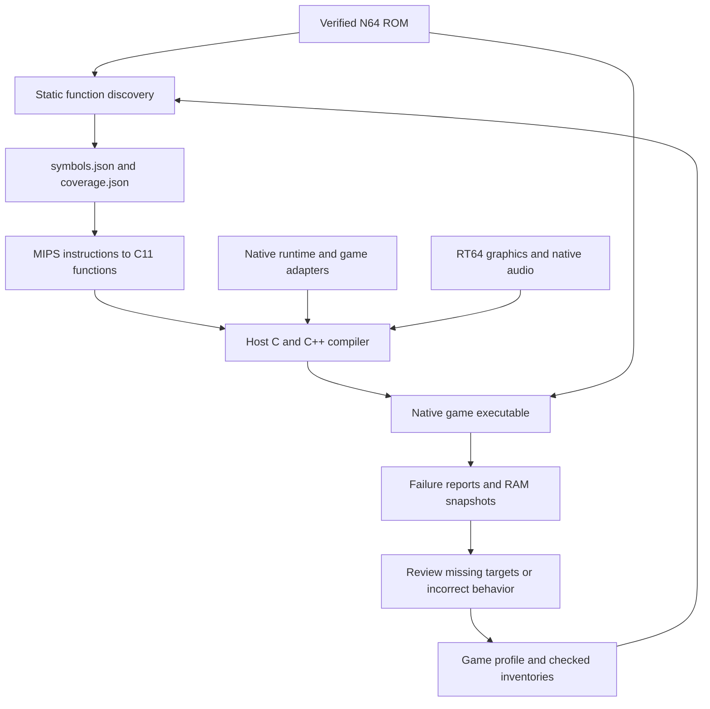

# v64recomp

Native N64 recompilation for Linux. ROM CPU instructions are translated from MIPS
to C11 and compiled for the host. Shared native services supply scheduling, OS,
input, saves and audio; RT64 supplies Vulkan graphics.

Super Mario 64 US is the working gameplay baseline. GoldenEye US reaches the
menus and playable Dam; its CPU inventory and broader gameplay validation remain
in progress. Shadow Man US runs original startup, graphics, audio and its
Controller Pak screen; title/gameplay work remains in progress.
Quake 64 US reaches the main menu and playable first level with movement and
shotgun firing; full-game validation remains in progress. Duke Nukem 64 US
reaches its menus and first level with RT64 graphics and ABI1 audio. Nightmare
Creatures US reaches its menus and playable Chelsea with RT64 graphics and ABI1
audio. See
[SM64](games/sm64-us/README.md), [GoldenEye](games/goldeneye-us/README.md),
[Shadow Man](games/shadowman-us/README.md), [Quake 64](games/quake-us/README.md),
[Duke Nukem 64](games/duke-us/README.md),
[Nightmare Creatures](games/nightmare-us/README.md)
and [the roadmap](PLAN.md).

## How recompilation works

The build starts with a verified game ROM. Rabbitizer decodes its MIPS CPU
instructions, the translation tools emit C11 functions, and the host compiler
turns those functions into a native executable. The original game still controls
its logic and reads its assets from the ROM. Shared native services implement
the N64 OS and hardware interactions required by each game.



### 1. Verify the ROM and describe its memory layout

Import accepts the common big-endian, byte-swapped and word-swapped N64 ROM
formats, normalizes the bytes, and verifies the expected size and SHA-1. Profiles
target exact ROM revisions; addresses and instruction fingerprints depend on
those bytes.

A ROM does not provide the ELF section and symbol information needed by the
translator. Each game's TOML profile supplies the relevant mappings from ROM
offsets to N64 virtual addresses, along with startup parameters, known function
roots and any special loading behavior. For example, Duke's profile maps its
initial `.main` region from ROM offset `0x1000` to guest address `0x8004B400`.
Such a mapped region can contain both code and data; mapping it does not classify
every byte as an instruction.

Builds do not require the original game's C source or a matching ELF/map. SM64's
complete inventory was cross-checked against a matching ELF/map during
development, but its build reads the stored inventory and ROM.

### 2. Discover functions without running the game

`tools/discover.py` walks instruction control flow from the ROM entry point,
profile roots and checked function entries. It follows direct calls, discovers
their targets, and explores both possible branch paths unless the instruction
itself proves one impossible. N64 branch delay slots are included in that
analysis. This stage does not need gameplay or a recorded execution trace.

Indirect transfers need additional information. A direct `jal` instruction
encodes its destination, while `jalr` takes a destination from a register.
Computed local jumps can select a target from a switch table. Profiles can supply
checked targets and jump tables, and registered indirect calls can resolve
against the compiled function registry at runtime.

Files such as [Duke's startup-entries.json](games/duke-us/startup-entries.json)
provide checked function starts for partial conversions:

| Field | Purpose |
| --- | --- |
| `format_version` | Identifies the inventory format. |
| `rom_sha1` | Binds the inventory to the exact normalized ROM. |
| `complete` | `false` identifies a partial function-entry inventory. |
| `entries[].vram` | Gives the original N64 address of a function entry. |
| `entries[].origin` | Records how the entry was identified: `direct-jal`, `stack-prologue` or `checked-root`. |
| `entries[].sha256` | Verifies the first 16 bytes at that address before using it. |

These entries seed discovery, including functions that may only be reached as
callbacks. The JSON supplies function starts; the profile supplies memory
regions. The entry fingerprint verifies the instruction prefix, rather than
claiming to describe the function's complete body or size.

Static discovery alone cannot guarantee every function has been found. Unused
code, function pointers, computed addresses and data that decodes as valid MIPS
instructions can leave ambiguities. Discovery reports unresolved transfers,
conflicting instruction ownership and unvisited ranges for review.

A complete inventory, such as
[SM64's code-inventory.json](games/sm64-us/code-inventory.json), additionally
classifies every byte of the configured regions as CPU code, data, native OS
code or RSP code. The tools validate contiguous range coverage and fingerprints,
and retain instructions in CPU code ranges even when the control-flow walk did
not visit them. Constructing that inventory can be done through static analysis
and review without playing the game. A complete inventory still needs separate
runtime validation; neither static coverage nor a gameplay trace proves that
every game scenario behaves correctly.

### 3. Translate MIPS semantics into C

`tools/translate.py` checks discovered functions and writes a coverage report
before emitting `functions.c` and `generated.h`. Unsupported instructions or
unresolved targets in selected ordinary functions prevent generation. Explicit
unsupported boundaries can be emitted as functions that fail if called; partial
conversions report those boundaries rather than implying full game support.

The generated C represents guest registers through `MipsContext`. Arithmetic
helpers preserve MIPS widths and sign extension, memory operations go through
guest address helpers, and branches become C control flow with the required
delay-slot behavior. For example, the instruction `addiu v0, v0, 1` is lowered
to an operation equivalent to:

```c
mips_set(ctx, 2, mips_s32((uint32_t)ctx->gpr[2] + (uint32_t)1));
```

This performs a wrapping 32-bit addition and sign-extends the result into the
64-bit guest register. The host compiler then produces machine code for it.
The game executes those compiled functions; CPU instructions are decoded during
generation rather than fetched and interpreted during play.

Guest addresses remain N64 addresses. The runtime maps them into its RDRAM
buffer, handles supported address aliases and game-specific mappings, and checks
memory access ranges. Floating-point helpers preserve the required guest
rounding and register behavior. See [floating point](docs/fpu.md) for details.

### 4. Connect the compiled game to native services

Generated functions are registered by their original guest addresses.
`recomp_lookup` resolves calls to a registered function in a loaded section;
unknown, unloaded or ambiguous destinations fail explicitly. Verified native
hooks with unique entries can be called directly while retaining section checks.

The [shared native hook catalog](docs/native-hooks.md) recognizes known OS and
library routines by their complete ROM-body fingerprints. These bind to native
implementations for threads, message queues, timers, devices, saves and selected
memory/string operations. Unrecognized ordinary routines keep their translated
CPU code. Game-specific adapters handle custom behavior such as virtual-memory
paging or graphics extensions.

Guest threads use native pthreads with a scheduler-controlled execution token.
Blocking OS operations park a thread and resume another according to guest
priorities. One guest CPU thread runs at a time, preserving interrupt critical
sections. Generated checkpoints provide safe scheduling and event boundaries.
Native services preserve guest memory structures, calling conventions and
completion events expected by the translated game.
See [native threading](docs/threading.md) for scheduling and worker ownership.

Graphics tasks pass to RT64 for Vulkan rendering. The translated game's audio
code builds command lists; the shared native audio backend executes supported,
verified ABI1 tasks to produce PCM in guest RAM. The native AI service supplies
buffer timing and completion events, and SDL plays the samples. Audio synthesis,
graphics display lists and presentation run on processing workers. Task workers
use private RAM snapshots; the host commits changed bytes before publishing SP
and DP events, and rejects conflicting guest writes to task output. SDL window
and input operations stay on the main thread. These task
backends implement supported graphics/audio behavior rather than translating
RSP microcode through the CPU translator. See [audio](docs/audio.md).

### 5. Record gaps and investigate runtime failures

Discovery, translation and controlled runtime failures produce different
artifacts:

| Artifact | What it records |
| --- | --- |
| `symbols.json` | Mapped sections, discovered functions, instruction addresses, discovery errors and unvisited ranges. |
| `coverage.json` | Function translation status, unsupported instructions/targets, metadata issues and inventory coverage. |
| Crash JSON | The controlled runtime failure and diagnostic state, with fields supplied by the game's app. |
| RDRAM snapshot | Guest memory saved alongside a controlled runtime failure. |

For Duke's rendered startup, the default controlled-failure outputs are
`build/duke-us/rom/startup/boot-report.json.crash.json` and
`build/duke-us/rom/startup/boot-report.json.rdram.bin`. Its crash report includes
the failing address, recent guest calls, thread registers, native call stack
and the latest available SP task. Other games can use different filenames and
include additional state. Thread PCs describe the last tracked location, not
an instruction-by-instruction execution trace.

```sh
# Discover and report Duke's conversion gaps without building or playing.
.venv/bin/python games/duke-us/run_duke.py --report-only

# Inspect a controlled runtime failure from a rendered Duke run.
.venv/bin/python tools/inspect_crash.py \
  build/duke-us/rom/startup/boot-report.json.crash.json
```

The repair workflow is to examine the failing target or operation, verify the
corresponding ROM bytes and control flow, update the checked metadata or native
implementation, regenerate, and validate the affected behavior. Unknown targets
are not automatically appended to the function inventory: a bad pointer also
needs investigation before its address is treated as executable code.

Crash JSON covers failures routed through `recomp_fail`. Host faults outside
those checks require a debugger or core dump. Early input/configuration errors
and compiler failures may only produce terminal output or build logs.

## MIPS → C → x86-64 in detail

The input is VR4300 machine code, with fixed 4-byte instructions. The intermediate
representation is C11 that explicitly models guest CPU state. GCC or Clang then
optimizes that C and emits x86-64 machine code ahead of time. Rabbitizer supplies
instruction decoding; [discovery](tools/discover.py),
[validation and generation](tools/translate.py), and [lowering](tools/emit.py)
are this project's own tools. The current floating-point backend requires Linux
x86-64 SSE2, even though C is used between the two instruction sets.

The generated C preserves the binary's operations and addresses. It does not
recover the original source's types, local variables or structured loops. A
guest function becomes a C function with this interface:

```c
void recomp_s0_80248c40(Runtime *runtime, MipsContext *ctx);
```

The name identifies section 0 and guest entry address `0x80248C40`. `runtime`
provides memory and native services; `ctx` holds that guest thread's registers.
The final executable contains compiled game functions, their address registry
and the native runtime. The ROM still supplies assets and bytes needed by guest
loading behavior. Loading a code section enables its already compiled functions;
there is no runtime CPU translation or instruction-fetch/decode loop.

### Static analysis: finding instructions and their owners

Discovery uses a worklist of function entries and, within each function, a
worklist of instruction addresses. The starting entries come from the ROM entry
point, profile roots, checked inventories and native replacement boundaries.
For each guest address, its configured region determines the ROM offset:

```text
rom_offset = region.rom_offset + (guest_address - region.vram)
```

The walker decodes a word, records it and queues successors. Previously expanded
addresses are skipped, so a loop does not make discovery loop forever. The
successors depend on the decoded instruction:

| Instruction or transfer | Static treatment |
| --- | --- |
| Ordinary instruction | Visit `pc + 4`. |
| Conditional branch | Include the delay slot at `pc + 4`, then explore the target and `pc + 8` continuation. |
| `jal` | Add the encoded destination as a function entry; include the slot and continue the caller at `pc + 8`. |
| `j` | Follow a local destination or recognize a transfer to another function. |
| `jr $ra` | Include the slot and terminate this return path. |
| Other `jr` / `jalr` | Require checked transfer information or the explicitly enabled registered-indirect-call policy. |
| `break` | Terminate the path at a fatal trap. |
| `syscall` / `eret` | Report the need for a native exception/OS boundary. |

A relative branch target is `(pc + 4 + sign_extend(imm16) * 4) mod 2^32`.
For `j` and `jal`, the target combines the high four bits of `pc + 4` with the
instruction's 26-bit target field shifted left by two. These destinations can
be computed from the ROM without executing the instruction.

Discovery prunes elementary identities such as `beq r, r` being always taken
and `bne r, r` being never taken. Emission also simplifies conditions proven
from the zero register. There is no general register-value propagation,
symbolic execution or automatic reconstruction of arbitrary function pointers.
A value assembled by several instructions does not automatically become a
checked indirect target.

Checked jump/function tables bridge that gap: the profile records the transfer
instruction's address and expected word, the table address and length, and a
SHA-256 of its ROM bytes. Discovery verifies these before reading the selected
table entries. Local computed jumps become a C `switch` over allowed guest
addresses, with a failure for an unlisted target. Registered indirect calls
instead resolve the register's value against the compiled function registry at
runtime; they cannot execute an arbitrary RAM address.

Finding another call target can change an earlier apparent local jump into a
transfer to a separate function. Discovery therefore walks again with the
expanded entry set before assigning instruction ownership. Functions that claim
the same instruction are omitted pending review. Unmapped targets, invalid
slots, unresolved transfers and discovery limits become explicit diagnostics.
The metadata records visited instruction addresses, rather than assuming every
byte between a function's first and last address was reached.

A complete checked inventory adds reviewed code/data boundaries to this walk.
Within a CPU-code range, successive checked entries define function spans;
the tool retains otherwise unreachable words in those spans and verifies their
bytes. This can preserve unused functions, alternate entries and padding that
reachability alone would miss. SM64's measured inventory below retains 4,755
words outside the initial walks. Mapping a ROM region alone provides none of
that classification. Discovery also currently rejects overlapping region
mappings; it does not infer overlay ownership automatically.

Before writing C, a second analysis checks supported opcodes, floating-point
register constraints, delay slots, transfer metadata and whether required
callees are included in the selected output. Coverage records `ready`, `hooked`,
`boundary` and `unsupported` functions. Ordinary selected functions with errors
block generation. These checks establish the translation's explicit boundaries;
runtime behavior still needs validation.

### Lowering guest state and control flow into C

[`MipsContext`](include/recomp.h) contains 32 64-bit general registers, HI/LO,
floating-point register bits and FCR31. Guest `$sp` is an address in guest RAM;
it is independent of the host's stack pointer. Guest stack loads/stores still
use memory helpers, while nested translated calls also create host C frames.

The helper layer preserves distinctions that ordinary C expressions can lose:

- Register zero reads as a constant zero, and `mips_set(ctx, 0, value)` discards
  the write. Tiny helpers are inline, so these decisions can disappear during
  compilation.
- `addiu`/`addu` wrap at 32 bits and sign-extend into a 64-bit register. The
  unsigned suffix does not mean their results are zero-extended. `addi`/`add`
  additionally detect signed overflow and report the guest trap.
- Shifts mask the count to the guest width. Multiply/divide helpers produce
  guest HI/LO results, including division corner cases.
- Loads/stores use 32-bit guest addresses, enforce supported widths and
  alignment, resolve aliases/pages, and preserve guest byte order. RDRAM uses
  word-swapped storage for RT64; a byte at physical offset `p` is stored at
  `rdram[p ^ 3]`.
- Floating-point helpers operate on raw register bits and preserve the supported
  rounding, exception and legacy MIPS NaN behavior. They do not substitute
  unrestricted host floating-point arithmetic.

Local branches use C conditions and `goto` labels. A branch condition must be
tested **before** its delay slot changes any input registers. For example:

```asm
beq   $a0, $zero, target
addiu $a0, $a0, 1          # delay slot: executes on either branch outcome
```

The following simplified fragment shows the emitter's ordering:

```c
if (ctx->gpr[4] == 0) {
    mips_set(ctx, 4, mips_s32(ctx->gpr[4] + 1));
    goto target;
}
mips_set(ctx, 4, mips_s32(ctx->gpr[4] + 1));
goto continuation;
```

Only one copy of the slot executes on a path. A branch-likely instruction omits
the untaken path's slot. Slot addresses remain independently reachable when
another branch targets them. Backward local transfers include scheduler
checkpoints; verified profile sites can request a yield.

For `jal`, generated code writes the guest return address `pc + 8` into `$ra`,
runs the slot, invokes the callee, then continues after the slot. For `jalr`, it
captures the destination before updating the link register or executing the
slot. Ordinary function calls use `recomp_lookup`, including calls whose MIPS
destination is fixed. Unique verified native hooks use a direct C handler call
with `recomp_prepare_direct_call` to retain loaded-section and preparation
checks. Guest return addresses remain meaningful even though host C frames
carry the usual return/resumption flow. `ctx->pc` tracks selected diagnostic
locations; it is not an interpreter's instruction pointer.

### A real MIPS → C → x86-64 example

SM64 US function `func_80248c40` begins with these ROM instructions:

```asm
# Guest PC   ROM word
# 80248C40   3C018033
lui  $at, 0x8033
# 80248C44   A020D600
sb   $zero, -0x2A00($at)
# 80248C48   03E00008
jr   $ra
# 80248C4C   00000000
nop                         # return's delay slot
```

The first two instructions clear the byte at guest address `0x8032D600`.
Their actual generated C is:

```c
/* 80248c40: lui $at, 0x8033 */
mips_set(ctx, 1, UINT64_C(0xffffffff80330000));
/* 80248c44: sb $zero, -0x2A00($at) */
recomp_store(runtime, ctx->gpr[1] - 10752, UINT64_C(0), 1);
```

`lui` produces the sign-extended 32-bit value in `$at`. The store's address
argument narrows to 32 bits; subtracting `0x2A00` produces `0x8032D600`.
There is no host pointer embedded at that guest address.

GCC 16.2.1 at `-O2` produced the following relevant x86-64 instructions in the
compiled object. This excerpt omits the surrounding prologue, saved guest return
address and return checks; unrelated instructions between these operations are
also omitted:

```asm
# System V arguments at entry: rdi = runtime, rsi = ctx
mov  ecx, 1                                      # store width
xor  edx, edx                                    # value = 0
mov  QWORD PTR [rsi+8], 0xffffffff80330000         # ctx->gpr[1]
mov  esi, 0x8032d600                              # guest address
call recomp_store                               # object relocation
```

The compiler inlines `mips_set`, folds the effective address into a constant,
and arranges `runtime`, address, value and width in host argument registers.
The five displayed instructions occupy 28 bytes versus 8 bytes for the two
MIPS operations: 3.5× for this excerpt. The shared `recomp_store` body and the
omitted function machinery are excluded from that local ratio. Instruction
mapping is consequently many-to-many: the optimizer can merge several guest
operations, eliminate dead operations or expand one operation into checks and
helper calls.

### Compiler intrinsics and their performance effect

`USE_INTRISICS` is the existing build switch, with that exact spelling. It
defaults to `1` in `include/recomp.h`; defining it as `0` selects the fallback.
Intrinsics are compiler-recognized operations that lower to host instructions.
They are distinct from ordinary inline C helpers, which the optimizer can also
turn into efficient instructions.

For signed 32-bit guest `ADD`/`SUB`, GCC/Clang overflow builtins express both the
arithmetic result and its overflow condition:

```c
int32_t result;
if (__builtin_add_overflow((int32_t)x, (int32_t)y, &result))
    recomp_fail("signed ADD overflow", 0);
return mips_s32(result);
```

On x86, this lets the compiler use an addition and its overflow flag, typically
an `add` followed by `jo`, instead of explicitly calculating overflow with
several XOR/AND operations. The fallback performs that portable bit calculation;
the optimizer may recognize it too. There is no fixed speedup per builtin.
Wrapping `ADDU`/`ADDIU` already use ordinary unsigned arithmetic and do not need
an overflow intrinsic.

The larger intrinsic path is in [`runtime/fpu.c`](runtime/fpu.c). Single-precision
operations use `_mm_add_ss`, `_mm_mul_ss`, `_mm_div_ss` and related scalar SSE
intrinsics; doubles use the SSE2 `_sd` counterparts. For example, the arithmetic
core of guest `ADD.S` includes:

```c
__m128 vx = _mm_set_ss(x), vy = _mm_set_ss(y);
z = _mm_cvtss_f32(_mm_add_ss(vx, vy));
```

That core lowers to scalar `addss` (or an equivalent encoding). It processes
one guest value, even though XMM registers can hold vectors. It does not batch
four guest instructions or reorder their exceptions. Register decoding, operand
checks, result handling and FCR31 updates still surround the arithmetic.

The runtime saves MXCSR, installs guest rounding, clears host exception flags,
masks host traps and disables DAZ/FTZ. After the operation it collects exception
flags and restores MXCSR and `errno`. This avoids the fallback's full
`feholdexcept`/`fesetround`/`fetestexcept`/`fesetenv` sequence for binary
arithmetic, square roots and comparisons, while leaving x87 state untouched.
Conversions can call libm and retain full `fenv` isolation in both modes.
Even the fallback can compile its ordinary arithmetic to SSE; much of the
intrinsic path's gain comes from the smaller environment-management path.
Both modes still require the current x86-64 backend and strict floating-point
compiler flags. See [floating-point support](docs/fpu.md) for its limits.

To compile both generated game code and runtime with the fallback, configure a
separate build after generating SM64's C:

```sh
cmake -S . -B build/renderer-no-intrinsics -G Ninja \
  -DCMAKE_BUILD_TYPE=Release -DRECOMP_BUILD_RT64=ON \
  -DCMAKE_C_FLAGS=-DUSE_INTRISICS=0
cmake --build build/renderer-no-intrinsics --target sm64_native_full_rt64
```

### Measured code expansion

Measured on **2026-10-14**, using SM64 US's complete generated output and its
up-to-date GCC 16.2.1 Linux x86-64 renderer-build object. Generated game code uses
effective `-O2`, `-g1`, `-fno-omit-frame-pointer`, `-fno-fast-math`,
`-frounding-math` and `-ffp-contract=off`, with intrinsics enabled and no LTO.
The output registers 4,373 translated functions and 52 native hooks.

| Representation | Bytes | MiB | Relative to translated MIPS bytes |
| --- | ---: | ---: | ---: |
| MIPS instructions in translated functions | 1,203,360 | 1.15 | 1.00× |
| Generated `functions.c` text | 37,720,792 | 35.97 | 31.35× |
| Compiled `functions.c.o` executable `.text` | 5,466,168 | 5.21 | 4.54× |

The MIPS denominator is 300,840 instruction words, including retained
unreachable words inside checked function spans. The inventory's `code` total
is 1,203,388 bytes; its 28 bytes of leading zero padding are excluded here.
Native-replaced bodies, data and RSP microcode are also excluded. The C file
includes comments, labels and registry definitions, so its ratio measures source
text expansion, not executable instructions. It contains 963,269 lines.

The x86 number counts the generated object's `.text`, including emitted helper
calls, checks and function alignment. It excludes shared runtime/helper bodies,
RT64, assets, registry data, unwind tables, debug information and the rest of
the executable. The generated machine code averages **18.17 bytes per 4-byte
MIPS word**; it is about 14.49% of the C source's byte size. Whole executable
size or whole ROM size would answer a different question.

To reproduce the measurement from an existing renderer build:

```sh
python3 - <<'PY'
import json
from pathlib import Path

base = Path('build/sm64-us/rom/full')
report = json.loads((base / 'coverage.json').read_text())
inventory = report['code_inventory']
mips_bytes = inventory['cpu_words'] * 4
c_bytes = (base / 'functions.c').stat().st_size
print(f'MIPS: {mips_bytes:,} bytes')
print(f'C: {c_bytes:,} bytes ({c_bytes / mips_bytes:.2f}x)')
PY

obj=build/renderer/games/sm64-us/CMakeFiles/sm64_native_full_rt64.dir/__/__/build/sm64-us/rom/full/functions.c.o
ninja -C build/renderer -n "${obj#build/renderer/}"
size -A "$obj"                   # use .text, not Total or object file size
objdump -dr -Mintel --disassemble=recomp_s0_80248c40 "$obj"
```

The denominator formula above applies to this complete SM64 inventory and full
generation. For partial builds, count only the instruction addresses belonging
to selected `ready` functions. Regenerate and build first if the Ninja check
reports pending compilation. Ratios vary with game, compiler, optimization,
sanitizers, debug configuration and translator changes.

### Where execution becomes faster

Ahead-of-time compilation removes repeated CPU instruction decoding and opcode
dispatch. The host compiler sees operations across whole C basic blocks and can
fold constants, inline small helpers, eliminate redundant computations and use
host registers. In the byte-store example it computes the guest address once
at compile time. These benefits explain why larger native code can execute
efficiently; a 4.54× byte expansion is neither a 4.54× slowdown nor a speedup
measurement.

Verified native OS/library replacements reduce work further: a thread/message
operation or supported memory routine runs its native implementation instead of
all the SDK's guest instructions. Direct calls to unique hooks remove registry
lookup from those call sites while keeping preparation and loading checks.
Ordinary translated calls and dynamic function pointers still pay lookup costs;
memory and floating-point helpers still have semantic checks. No interpreter/JIT
comparison or whole-game speedup percentage is established by these size data.

A focused helper benchmark on **2026-10-14** measured the intrinsic path against
the fallback on an AMD Ryzen 7 5700X with GCC 16.2.1:

| Repeated guest operation | `USE_INTRISICS=0` | `USE_INTRISICS=1` | Helper throughput gain |
| --- | ---: | ---: | ---: |
| `ADD.S` | 138.16 ns/op | 18.79 ns/op | 7.35× |
| `ADD.D` | 140.08 ns/op | 19.75 ns/op | 7.09× |

Each measurement includes the full `mips_fp_binary` call, guest register
reads/writes, operand/result checks and environment handling. Both executables
compiled the same `runtime/fpu.c` and harness at `-O2`, with
`-fno-omit-frame-pointer -fno-fast-math -frounding-math -ffp-contract=off`,
without LTO or sanitizers; only `-DUSE_INTRISICS=0/1` differed. The harness
provided an aborting `recomp_fail` implementation instead of linking the game.
Processes were pinned to the same logical CPU, timings used `CLOCK_MONOTONIC`,
and the table gives medians of five trials per mode with alternating mode order.

Each trial warmed up for 10,000 calls, reset the accumulator, then timed
2,000,000 dependent additions of `1.0` to guest FPR 0 using FPR 2 as the constant:

```c
/* ctx is zero-initialized: FR=0, round-to-nearest, exception enables clear.
 * FPR 2 contains 1.0 in the selected format; FPR 0 starts at 0.0.
 * Double registers use the 0/1 and 2/3 pairs. */
for (unsigned i = 0; i < 2000000; ++i)
    mips_fp_binary(&ctx, 0, 0, 2, format, MIPS_FP_ADD);
```

Both modes returned exactly `2,000,000.0` with FCR31 unchanged. This benchmark
measures ordinary finite additions and includes loop/call overhead. It does not
measure conversions, exceptional operands, game dispatch, memory, rendering or
gameplay, and is not a full floating-point conformance test. It demonstrates the
gain from this particular helper path; it does not establish a 7× game speedup.

An end-to-end gain depends on how much frame time the optimized path originally
consumed. If a path accounts for fraction `f` of elapsed time and becomes `s`
times faster, the ideal total speedup is `1 / ((1 - f) + f / s)`. For example,
a 5× improvement in a path occupying 10% of frame time yields only about 1.09×
overall. GPU work, rendering workers, audio, synchronization and frame pacing
can dominate or overlap CPU work. Establish a gameplay gain with the same ROM,
input sequence, scene, renderer settings and build flags, measuring CPU time
and frame-time distribution in addition to FPS; an FPS cap can hide CPU savings.

## Setup

Requirements: Python 3.11+, a C/C++ compiler, CMake, Ninja, OpenSSL 3, SDL2, X11
or Xwayland, Vulkan and the populated RT64 checkout in `third_party/rt64/`.
Run commands from this checkout's root:

```sh
python3 -m venv .venv
.venv/bin/python -m pip install -r requirements.txt
# Optional texture tools:
.venv/bin/python -m pip install -r requirements-textures.txt
```

Import each supported ROM once. ROMs, saves and texture packs stay in `local/`.

```sh
.venv/bin/python tools/import_rom.py \
  --profile games/sm64-us/full.toml --rom '/path/to/Super Mario 64 (U).v64'
.venv/bin/python games/goldeneye-us/run_goldeneye.py \
  --rom '/path/to/007 - GoldenEye.v64' --report-only
.venv/bin/python games/shadowman-us/run_shadowman.py \
  --rom '/path/to/Shadow Man (U) [!].z64'
.venv/bin/python games/quake-us/run_quake.py \
  --rom '/path/to/Quake 64 (U) [!].z64'
.venv/bin/python games/duke-us/run_duke.py \
  --rom '/path/to/Duke Nukem 64 (U) [!].z64'
.venv/bin/python games/nightmare-us/run_nightmare.py \
  --rom '/path/to/Nightmare Creatures (U) [!].z64' --render --frames 0
```

## Build and run

Each launcher regenerates its CPU sources and builds the game with the shared
runtime and RT64. Build output stays in `build/`; the RT64 source tree stays clean.

```sh
.venv/bin/python games/sm64-us/run_sm64.py --render --build-only
.venv/bin/python games/goldeneye-us/run_goldeneye.py --render --build-only
.venv/bin/python games/shadowman-us/run_shadowman.py --render --build-only
.venv/bin/python games/quake-us/run_quake.py --render --build-only
.venv/bin/python games/duke-us/run_duke.py --render --build-only
.venv/bin/python games/nightmare-us/run_nightmare.py --render --build-only

.venv/bin/python games/sm64-us/run_sm64.py --render
.venv/bin/python games/goldeneye-us/run_goldeneye.py --render
.venv/bin/python games/shadowman-us/run_shadowman.py --render --frames 0
.venv/bin/python games/quake-us/run_quake.py --render --frames 0
.venv/bin/python games/duke-us/run_duke.py --render --frames 0
.venv/bin/python games/nightmare-us/run_nightmare.py --render --frames 0
```

The executables are `build/renderer/sm64_native_full_rt64` and
`build/renderer/goldeneye_native_rt64`, `build/renderer/shadowman_native_rt64`
and `build/renderer/quake_native_rt64`, `build/renderer/duke_native_rt64`,
`build/renderer/nightmare_native_rt64`.
Add `--jobs N` to control build parallelism. SM64 and GoldenEye accept
`--cheat-menu` for their session-only debug/unlock menus.
Press **F1** while rendering to toggle RT64's ImGui debug inspector. It provides
graphics settings, workload debugging and performance statistics. Keyboard input
captured by the inspector is withheld from the game's controller. Graphics
settings changes apply to the current session.
Rendering defaults include 4x resolution, 4x MSAA, widescreen expansion to the
window's aspect ratio and texture LOD scaling. The bundled RT64 revision lacks
the ray-tracing renderer implementation, so ray tracing is unavailable.

### Debug in VS Code

Open this checkout's root in VS Code with the Microsoft C/C++ extension and GDB
installed. In **Run and Debug**, select **Debug: <game>**, set a breakpoint, and
press **F5**. Each of the six games has a matching build task that regenerates
its CPU sources and builds its executable in `build/debug` before launching
with live controls and no frame limit. The first build also compiles RT64.

Debug builds include full symbols and disable optimization for game code.
Breakpoints work in `games/`, `runtime/`, `backends/`, and the translated
`build/<game>-us/rom/full/functions.c` (SM64) or
`build/<game>-us/rom/startup/functions.c` (other games). Generated sources are
rewritten by the build task; put persistent changes in the translator or native
code. Debug builds can run slower than the normal builds.

The same build is available from the command line; all game launchers accept
`--debug` with `--render`:

```sh
.venv/bin/python games/sm64-us/run_sm64.py --render --debug --build-only
```

To build just the shared runtime and audio:

```sh
cmake -S . -B build/host -G Ninja
cmake --build build/host
```

## Layout

- `games/<game>/`: applications, profiles, inventories, launchers, game-specific
  audio recognition, graphics extensions and capture inspection.
- `runtime/` and `include/`: shared native services and interfaces.
- `backends/`: shared RT64, audio and texture adapters.
- `tools/`: shared ROM import, discovery, translation, builds and texture tools.
- `third_party/`: RT64 and the audio DSP dependency.
- `local/`: ignored ROMs, saves, texture packs and driver caches.
- `build/`: disposable generated code, compiled output and captures.

[Audio](docs/audio.md), [floating point](docs/fpu.md) and
[texture workflow](docs/textures.md) document the shared services.
Common OS, memory and string routines use a [shared native hook catalog](docs/native-hooks.md)
automatically, with explicit game-profile overrides for custom behavior.

When adding a game, reuse the shared native hook catalog for plain OS/library
calls. Add newly verified SDK variants and any missing ordinary services to the
shared catalog/runtime; game-profile hooks are reserved for game-specific
customization. See the [hook contribution rules](docs/native-hooks.md).
