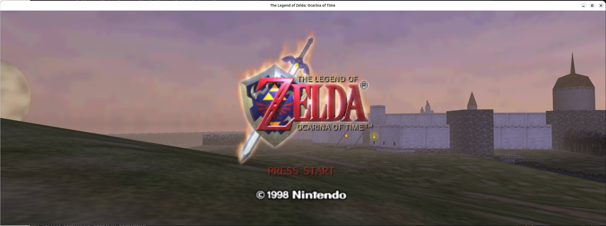
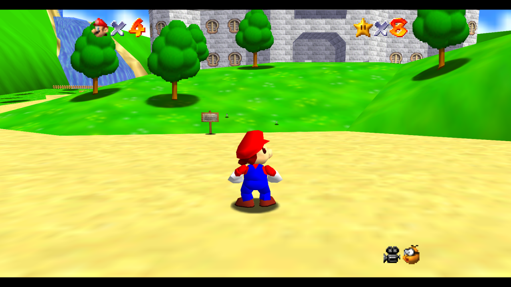
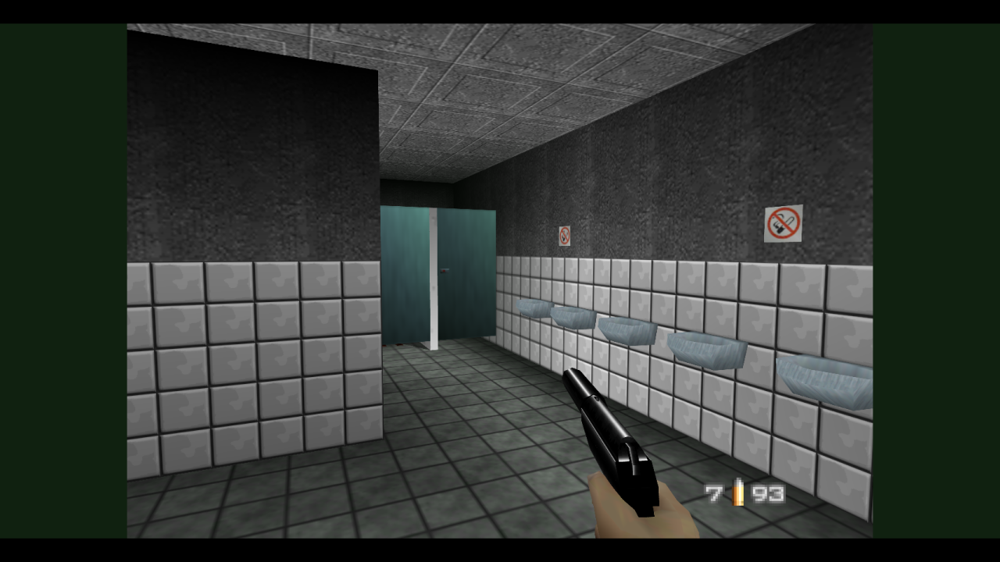
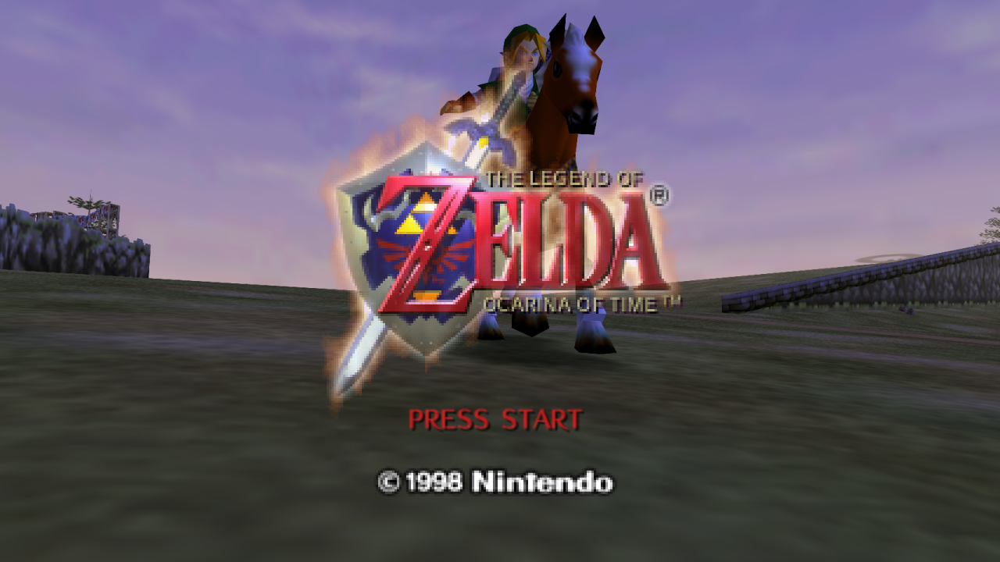
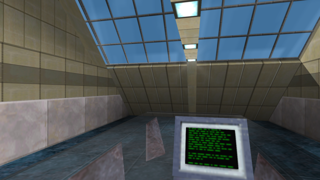

# v64recomp

**Your N64 favorites, with room to stretch out.**

v64recomp rebuilds N64 games as native Windows and Linux applications. Bring your
own ROM, build the game, and settle in with a wider view, familiar controls and
a few comforts that weren't around in the cartridge days.

| Make it yours | What you can do |
| --- | --- |
| **[Widescreen and ultrawide](#a-little-more-room-to-see)** | Expand the view to fit your window with **F7**, or keep the original proportions. |
| **[Texture packs, built right in](#your-favorite-textures-in-one-place)** | Load a compatible texture ZIP directly, or embed it in the executable so it comes along whenever you move the game. |
| **[Adjustable field of view](#controls-that-feel-familiar)** | Find a comfortable view with **keypad + / −**, from the original angle up to **140°** in supported games. |
| **[WASD and mouse](#controls-that-feel-familiar)** | Move, look and aim with familiar PC controls in supported games, including mouse menu navigation in GoldenEye. |
| **[Steam Deck and preset controls](#take-it-to-your-steam-deck)** | Play through a native Linux package with a **1280×800 expanded view** and the included **v64recomp - N64** Steam Input layout. |
| **[Low CPU usage](#a-lighter-load-on-your-steam-deck)** | Static recompilation and RT64's optimized Vulkan pipeline are designed to keep CPU work light, including on Steam Deck. |

[Get started](#build-and-play) · [Games and progress](#games-and-progress) ·
[Controls](#controls-and-data) · [How it works](#technical-information-how-it-works)



*Ocarina of Time, captured from the native build with RT64 widescreen expansion.*

This is an active porting project. Some games already reach playable levels;
others are still at their first menus. The [game notes](docs/status.md) explain
what has been tried and what still needs work, so you can choose where to start.

## Make yourself at home

### A little more room to see

Have a wide monitor? Resize the game window and press **F7** to expand the view.
Press it again to return to the game's original aspect ratio. Desktop builds
start with the original proportions in a 1280×960 window; Steam Deck packages
start at 1280×800 with expansion already enabled.

RT64 also provides 4× rendering resolution, 4× MSAA to soften jagged edges, and
interpolated rendering targeting 60 FPS. The game's logic and audio keep their
original timing. Widescreen and the adjustable camera FOV are separate settings,
so you can choose your screen shape and viewing angle independently.

### Your favorite textures, in one place

Already have a compatible Rice/GLideN64 texture pack? Pass the ZIP straight to
the game. There's no need to unpack it or convert it first:

```sh
./build/sm64-us-release/bin/sm64-us --texture-pack /path/to/pack.zip
```

Want the pack to travel with your build? **Embed the texture ZIP in the
executable** when you compile it:

```sh
cmake --preset sm64-us-release -DRECOMP_EMBED_TEXTURE_PACK=/path/to/pack.zip
cmake --build --preset sm64-us-release
```

The game then loads those textures automatically, without the original ZIP
beside it. This works in Debug and Release, with or without ROM embedding.
You can still choose another pack with `--texture-pack`.

Press **F5** to switch between the original and replacement textures and reload
pack changes. Textures without a matching replacement keep their original look.
To export original textures as PNGs with JSON metadata, pass `--texture-dump DIR`
to any game in Debug or Release. The directory is created automatically as needed.
See the [texture guide](docs/textures.md) for supported filenames, loose folders,
texture dumps and matching caches.

### Controls that feel familiar

If you're most comfortable with a keyboard and mouse, these games include
adapters enabled by default on desktop. Each one follows the game's own movement
and camera rules; the linked guides cover buttons, sensitivity and controller
fallback.

| Game | Keyboard and mouse | Adjustable FOV |
| --- | --- | --- |
| GoldenEye 007 | [WASD, mouse-look, aiming and menu cursor](games/goldeneye-us/README.md#mouse-and-keyboard) | [Original → 140°](games/goldeneye-us/README.md#field-of-view) |
| Quake 64 | [WASD, mouse-look and weapon cycling](games/quake-us/controller.md) | [90° → 140°](games/quake-us/README.md) |
| Quake II | [WASD, mouse-look and weapon cycling](games/quake2-us/controller.md) | — |
| Duke Nukem 64 | [WASD, mouse-look and combat controls](games/duke-us/controller.md) | [Original → 140°](games/duke-us/README.md#field-of-view) |
| Hexen | [WASD, mouse-look, combat and inventory](games/hexen-us/controller.md) | [Original → 140°](games/hexen-us/README.md#field-of-view) |
| Ocarina of Time US V1.2 | [WASD and third-person camera orbit](games/oot-us-v12/controller.md) | [Original → 140°](games/oot-us-v12/README.md#field-of-view) |
| Rayman 2 | [WASD and native mouse camera controls](games/rayman2-us/README.md#keyboard-mouse-and-field-of-view) | [Original → 140°](games/rayman2-us/README.md#keyboard-mouse-and-field-of-view) |
| Turok US v1.2 | [WASD, mouse-look, weapons and automap](games/turok-us-v12/controller.md) | [Original → 140°](games/turok-us-v12/controller.md) |
| Nightmare Creatures | [WASD, mouse steering, dodges and combat](games/nightmare-us/controller.md) | — |

**FOV** means field of view: how much of the world you can see at once. In the
games listed with FOV controls, use **keypad + / −** to change the horizontal
angle one degree at a time, or hold a key to keep adjusting. Each launch starts
at the original view; lowering the setting to its minimum restores that view.
GoldenEye retains its native weapon zoom. These controls work in both builds.

Mouse support is specific to each game and mode. For example, Ocarina of Time's
mouse orbits the normal follow camera; first-person aiming keeps the native
controls. Nightmare Creatures uses horizontal mouse motion to turn the character.
The game guides record these limits and the current testing status, including
FOV changes that still need gameplay validation.

To get your desktop cursor back, press **Escape**; **F4** recaptures it for play.
Use **F10** or close the window to quit. Gamepads remain available; release mouse
capture or use the game's documented mouse-disable setting for its original
controller bindings.

### Take it to your Steam Deck

The Deck package runs natively on SteamOS and includes a ready-made controller
layout. After the [initial setup and ROM import](#build-and-play), build it on
an x86_64 Linux PC with:

```sh
./tools/build_steamdeck.sh oot-us-v12 4
```

The [Steam Deck guide](docs/steamdeck.md) walks through the container dependencies,
copying the package and your ROM, and adding `launch.sh` as a non-Steam game.
Keep Steam Input enabled and leave forced compatibility tools disabled.

From the extracted package in Desktop Mode, install the included preset:

```sh
./install-controls.sh
```

Restart Steam, then choose **Controller settings → current layout → Templates →
v64recomp - N64 → Apply Layout**. Launch through Steam so the layout is active.
You can also start with Steam's built-in **Gamepad** template.

The preset keeps analog movement and adds convenient C-button shortcuts on the
right trackpad and rear buttons. In the **Ocarina of Time Deck package**, the
left stick moves Link, the right stick positions the normal follow camera, and
the D-pad handles C-buttons, including ocarina notes. A/X are action/sword, the
left trigger targets, and the right trigger or bumper raises the shield.

See the [complete controller layout](tools/steamdeck/steam-input/README.md) to
make it your own. Hardware gameplay and performance coverage are still being
expanded; the package is not a claim that every port is fully tested on Deck.

### A lighter load on your Steam Deck

The design aims for **very low CPU usage on Steam Deck**. Static recompilation translates
the game's CPU instructions **once, when you build**, into native machine code.
During play, your Deck runs that compiled code directly. RT64's optimized Vulkan
pipeline handles rendering on the GPU, with asynchronous upload, rendering and
presentation work that can overlap the game CPU work.

Together, these help keep CPU work light on a handheld. Actual CPU usage depends
on the game, scene and settings; shader compilation and Debug builds can add
extra work. For a look at your own Release build, the [built-in profiler](docs/profiling.md#built-in-profiler-including-steam-deck)
works on Deck without installing extra tools.

## Build and play

You'll need your own ROM for the exact revision the game profile expects.
The import tool checks it for you, so there's no need to rename files or convert
byte order by hand. ROMs and texture packs aren't included.

### 1. Get the source and dependencies

Clone with submodules so RT64 and its dependencies come along too:

```sh
git clone --recurse-submodules https://github.com/polaco1782/v64recomp.git
cd v64recomp
```

Already have a checkout? Run `git submodule update --init --recursive` from its
root. CMake uses those local sources; it doesn't download missing submodules.

| Platform | What to prepare |
| --- | --- |
| **Windows** | Follow [Windows setup](docs/windows.md) for Visual Studio, Python and vcpkg dependencies. Open `v64recomp.sln`, select your game and build Release. |
| **Linux** | Python 3.11+, a C/C++ compiler, CMake 3.25+, Ninja, OpenSSL 3, SDL2, libcurl 7.85+, X11/Xwayland and a Vulkan-capable driver. |
| **Steam Deck** | Follow the [container build guide](docs/steamdeck.md) on your Linux PC. It uses Debian 12 so the package doesn't depend on newer host libraries. |

On Linux, install the Python build dependencies from the checkout root:

```sh
python3 -m venv .venv
.venv/bin/python -m pip install -r requirements.txt
```

### 2. Import your ROM

Here's Super Mario 64 US as an example:

```sh
.venv/bin/python tools/import_rom.py \
  --profile games/sm64-us/profile.toml --rom '/path/to/Super Mario 64.v64'
```

For Ocarina of Time, use the **US V1.2** ROM and its matching profile:

```sh
.venv/bin/python tools/import_rom.py \
  --profile games/oot-us-v12/profile.toml --rom '/path/to/Ocarina of Time.n64'
```

The importer accepts `.z64`, `.v64` and `.n64`, verifies the exact size and SHA-1,
and copies the normalized ROM into ignored `local/`. It rejects a mismatched
revision or a destination containing different bytes. On Windows, use
`.\.venv\Scripts\python.exe` in place of `.venv/bin/python` after setup.

### 3. Build, then play

On Linux, run:

```sh
cmake --workflow --preset sm64-us-release
./build/sm64-us-release/bin/sm64-us
```

Replace `sm64-us` with your [game ID](#games-and-progress). The first build also
compiles the shared renderer, so give it a little time. Later builds reuse it.
The executable can launch from any working directory. You can also launch with
`cmake --build --preset sm64-us-release --target run`.

On Windows, use the Visual Studio solution or [VS Code launch entries](docs/windows.md#vs-code).
For command-line builds, the [Windows guide](docs/windows.md) has the matching
PowerShell commands and executable paths.

## Games and progress

These are starting points for exploration, not promises of full-game completion.
Each title links to its own setup and port notes; [support status](docs/status.md)
keeps the detailed validation history and known gaps.

| Game | Game ID | Current milestone |
| --- | --- | --- |
| [Super Mario 64](games/sm64-us/README.md) | `sm64-us` | Castle Grounds gameplay and castle lobby transition. |
| [GoldenEye 007](games/goldeneye-us/README.md) | `goldeneye-us` | Menus and playable Dam. |
| [Ocarina of Time US V1.2](games/oot-us-v12/README.md) | `oot-us-v12` | File selection and new-game opening; broader validation in progress. |
| [Perfect Dark US V1.1](games/perfectdark-us-v11/README.md) | `perfectdark-us-v11` | Carrington Institute and a tested mission transition. |
| [Quake 64](games/quake-us/README.md) | `quake-us` | Original menus and playable first level. |
| [Quake II](games/quake2-us/README.md) | `quake2-us` | Strogg Outpost gameplay; Expansion Pak enabled. |
| [Duke Nukem 64](games/duke-us/README.md) | `duke-us` | Menus and first-level gameplay. |
| [Hexen](games/hexen-us/README.md) | `hexen-us` | Class selection and first-level fighter gameplay. |
| [Nightmare Creatures](games/nightmare-us/README.md) | `nightmare-us` | Character selection and playable Chelsea. |
| [Shadow Man](games/shadowman-us/README.md) | `shadowman-us` | Menus, movement and rendered level progression. |
| [Turok: Dinosaur Hunter US v1.2](games/turok-us-v12/README.md) | `turok-us-v12` | Experimental; first-person gameplay and automap. |
| [1080 Snowboarding JU revision 0](games/1080-us/README.md) | `1080-us` | Intro, title and Select Rider; riding unvalidated. |
| [Resident Evil 2 US revision 1](games/re2-us-v1/README.md) | `re2-us-v1` | Experimental; opening movie and title menu. |
| [Rayman 2](games/rayman2-us/README.md) | `rayman2-us` | Experimental; title and language selection. |
| [Conker's Bad Fur Day](games/conker-us/README.md) | `conker-us` | Experimental; logo intro and audio. |
| [Duke Nukem: Zero Hour](games/duke-zero-hour-us/README.md) | `duke-zero-hour-us` | Copyright/logo screens; gameplay bring-up in progress. |
| [007: The World Is Not Enough](games/twine-us/README.md) | `twine-us` | Experimental; startup and audio bring-up in progress. |

<details>
<summary>ROM filenames and checksums</summary>

Import is the easiest way to check your ROM: it verifies size and SHA-1 against
`games/<game>/profile.toml`. These MD5 values identify the normalized files:

| Filename | MD5 |
| --- | --- |
| `1080.ju.z64` | `fa27089c425dbab99f19245c5c997613` |
| `duke-zero-hour.us.z64` | `026789d47db5fe202a76f89797b33ac7` |
| `duke.us.z64` | `c7f1a43764a26da2e43f2a36a5f76e4c` |
| `conker.us.z64` | `00e2920665f2329b95797a7eaabc2390` |
| `goldeneye.us.z64` | `22ff6c18eb028792ef350554b1e1fa68` |
| `hexen.us.z64` | `eb98f1b8c6898af7417f6882946da9b3` |
| `nightmare.us.z64` | `4116cf435db315a2481af8d1e9352feb` |
| `oot.us.v12.z64` | `57a9719ad547c516342e1a15d5c28c3d` |
| `perfectdark.us.v11.z64` | `e03b088b6ac9e0080440efed07c1e40f` |
| `quake2.us.z64` | `cc93c30c633ff461c29b54ceabefd701` |
| `quake.us.z64` | `097605021951024c3ecb2d502c0c2a9f` |
| `rayman2.us.z64` | `03aa4d09fde77eed9b95be68e603d233` |
| `re2.us.rev1.z64` | `1add2c0217662b307cdfd876b35fbf7a` |
| `shadowman.us.z64` | `b457298b87b85bbf950f24867daa9475` |
| `sm64.us.z64` | `20b854b239203baf6c961b850a4a51a2` |
| `turok.us.v12.z64` | `039875b92c0e4fef9797ec1744877b17` |
| `twine.us.z64` | `9d58996a8aa91263b5cd45c385f45fe4` |

</details>

## Screenshots

A few moments captured from the native builds:

| Super Mario 64 · Castle Grounds | GoldenEye 007 · gameplay |
| --- | --- |
|  |  |
| **Ocarina of Time · title screen** | **Perfect Dark · Carrington Institute** |
|  |  |

## Controls and data

Keep these shortcuts handy while you play:

| Key | What it does |
| --- | --- |
| **F7** | Switch between original aspect ratio and widescreen expansion. |
| **F5** | Reload texture packs and switch original/replacement textures. |
| **Keypad + / −** | Adjust FOV in the [five supported games](#controls-that-feel-familiar). |
| **F12** | Open the shared GameShark cheat menu. |
| **Escape / F4** | Release / recapture the mouse when a mouse adapter is enabled. |
| **F10 (mouse mode) / close window** | Quit. With the original keyboard mapping, Escape quits. |

The default gamepad mapping uses the left stick for analog movement, the right
stick for C-buttons, A/X for N64 A/B, left trigger for Z, right trigger/bumper for
R, and Menu/Start for Start. The D-pad stays the N64 D-pad. Ocarina of Time's
Deck mode uses right-stick camera control and D-pad C-buttons instead.

Without a game-specific mouse adapter, the shared keyboard mapping is arrows
for the stick, A/X/Z for N64 A/B/Z, S for Start, C/V for L/R, and I/J/K/L for
C-buttons. See the [individual control guides](#controls-that-feel-familiar)
for the WASD layouts.

ROMs, saves, texture packs and crash dumps stay in ignored `local/`. Loose texture
replacements default to `local/textures/<game>/replacements`;
`RECOMP_TEXTURE_REPLACEMENTS` selects another location. The [texture guide](docs/textures.md)
covers ZIP overrides and disabling replacements. The [cheat menu](docs/cheats.md)
downloads ROM-specific codes from Mupen64Plus and Project64 and caches them for
offline use.

If something goes wrong, controlled failures in both builds save a JSON report
and RAM snapshot to `local/crashes/<game>/`. Keep the executable and generated
sources with the report; `tools/inspect_crash.py` helps inspect it. Host faults
outside those checks need a debugger or core dump. See [debugging](docs/debugging.md)
and [live code repair](docs/live-repair.md) for the next steps.

## More build options

<details>
<summary>Build presets, compiler selection and the shared RT64 cache</summary>

Every game has Release and Debug workflows, such as `quake2-us-release` and
`quake2-us-debug`. A workflow configures the selected build tree, promotes any
published live functions from `local/live-patches/<game>/` into its checked
profile, then builds it with four compiler jobs. Promotion validates every
function through normal generation before clearing temporary patch files; a
failed promotion stops the workflow and keeps those files. List workflows with
`cmake --workflow --list-presets`.
For an incremental build with a different job count, use
`cmake --build --preset quake2-us-release -j 8`. Configure custom `-D` options
separately with `cmake --preset quake2-us-release -DOPTION=VALUE`; subsequent
workflows retain cached options that the preset does not override.

Release builds optimize generated CPU code for size (`-Oz`, falling back to
`-Os`; `/O1 /Os` on MSVC), while the runtime and native adapters retain their
speed optimization. Generated CPU objects avoid LTO, and unused sections can be
discarded. Set `-DRECOMP_OPTIMIZE_SIZE=OFF` to use the previous compiler policy.
Linux Release executables keep their debug information in a compressed matching
`bin/<game>.debug` file. Keep that file for source-level diagnostics; it is not
required to play. Set `-DRECOMP_SEPARATE_DEBUG_INFO=OFF` to retain debug information
inside the executable. MSVC continues to produce PDB files. Native games build
as position-independent executables on Linux, including an explicit PIE link.
See the [size measurements](docs/code-expansion.md#release-build-policy).

CMake prefers Clang (`clang`/`clang++`), falling back to GCC (`gcc`/`g++`) when
the corresponding Clang compiler is unavailable. Explicit `CC`/`CXX`,
`CMAKE_C_COMPILER`/`CMAKE_CXX_COMPILER`, and toolchain selections take precedence.
Existing build directories keep their cached compiler; use a new build directory
to apply the default to a previously configured build.

The equivalent explicit CMake configuration is:

```sh
cmake -S . -B build/quake-release -G Ninja -DRECOMP_GAME=quake-us -DCMAKE_BUILD_TYPE=Release
cmake --build build/quake-release -j 4
cmake --build build/quake-release --target run
```

CMake selects one game per build tree and regenerates CPU sources when the ROM,
profiles, inventories or generator change. Unchanged generation is cached. Missing
ROMs or generation failures stop configuration explicitly. The generation log is
in the build directory. CPU sources are split into smaller files for parallel
compilation. Use `-DRECOMP_GAME=none -DRECOMP_BUILD_RT64=OFF` to build shared libraries.

RT64, its shaders and bundled libraries build once under `build/shared/rt64/`
and are reused by every game and both game modes. The shared build uses
`RelWithDebInfo` by default; `-DRECOMP_RT64_BUILD_TYPE=Release` selects another
renderer configuration. Compiler, toolchain and relevant flag changes select a
separate cache directory. Source edits rebuild the affected RT64 files.
`-DRECOMP_RT64_JOBS=4` controls its compiler jobs, independently of game build
parallelism. Builds from different game directories serialize access to RT64.
Cleaning a game removes its local library links while retaining the shared cache.

</details>

<details>
<summary>Bundle ROM content or compress an executable</summary>

To include the game's ROM content in the executable with verified CPU code
zeroed before embedding:

```sh
cmake --preset sm64-us-release -DRECOMP_EMBED_ROM=ON
cmake --build --preset sm64-us-release -j 4
./build/sm64-us-release/bin/sm64-us
```

The original ROM is required to build, but embedded builds launch without an
external ROM. `--rom PATH` still loads and verifies an original ROM for comparison.
`-DRECOMP_EMBED_ROM=OFF` restores external-ROM builds (the default).
See [ROM content packaging](docs/rom-packaging.md) for supported layouts,
removal reports and the limits of code stripping.

To pack the final executable, install [UPX](https://upx.github.io/) and run:

```sh
cmake --build --preset sm64-us-release --target pack -j 4
```

The `pack` target builds the game, then uses `upx --best --ultra-brute` and checks
the packed file with `upx --test`. It writes `bin/packed/sm64-us` in the build
directory and keeps the original executable. These maximum compression settings
can take a long time. Packing is optional and works with every game, including
embedded-ROM builds. CMake automatically finds UPX on `PATH` and caches its path
globally for the build tree, preserving an explicitly configured path.
If UPX is outside `PATH`, configure with
`-DRECOMP_UPX_EXECUTABLE=/path/to/upx`.

To bundle replacement textures, use the [texture embedding steps](#your-favorite-textures-in-one-place).

</details>

## Release and debug

Use **Release** for everyday play and performance measurements. **Debug** adds
the tools for investigating a port. Both keep runtime correctness checks and
shared crash reporting.

<details>
<summary>Debug commands, captures, profiling and project layout</summary>

`games/<game>/main.c` contains one entry point, bootstrap and frame loop for
both builds. Game headers, adapters, generation helpers and maintained replay
inputs live beside it. There are no per-mode source folders or runner wrappers.
Small `#ifdef RECOMP_DEBUG` blocks contain any game-specific diagnostics;
shared replay, capture, audio recording and tracing are provided by the runtime.
See [the game layout and starter pattern](docs/adding-a-rom.md#7-add-the-native-application-and-cmake-integration)
when adding a title.

Release retains correctness checks and shared crash reporting without routine
reports or captures. Debug adds symbols, unoptimized game code, tracing,
optional captures, RT64's F1 inspector and F6 wireframe.
Both modes reuse RT64's optimized `RelWithDebInfo` build by default. Game code,
the shared runtime and native adapters retain their selected configuration flags.

For a pause and in-process repair of missing compiled code or checked
indirect targets, see [live code repair](docs/live-repair.md).

For thread CPU usage and sampled function call stacks, see
[CPU profiling](docs/profiling.md). `tools/profile_execution.py` attaches to a
running game and saves thread counters and optional perf reports under
`build/profiles/`.

```sh
cmake --workflow --preset quake-us-debug
./build/quake-us-debug/bin/quake-us --frames 300 --capture-every 60
./build/quake-us-debug/bin/quake-us --trace-calls
cmake --build --preset quake-us-debug --target report
```

All executables accept `--help`, `--rom FILE`, `--data DIR`, `--save FILE`,
`--crash-dir DIR`, `--frames N` (0 runs until close), and `--mute`.
Debug additionally supports `--input FILE`, `--wav FILE`, `--audio-trace FILE`,
`--capture-every N`, and `--trace-calls`. Per-game availability is listed in
[the debug workflow](docs/debugging.md). For the CMake run target, pass arguments
with `-DRECOMP_RUN_ARGS='--frames;300;--mute'` at configuration.

VS Code's **Debug: <game> (Windows)** and **Release: <game> (Windows)** configurations
build with MSVC and launch the matching `.exe` with the Visual Studio debugger;
see [VS Code on Windows](docs/windows.md#vs-code) for setup and output paths.
The **(Linux)** configurations configure/build the matching Ninja preset and
launch with GDB. Breakpoints work in game adapters, the shared runtime, backends
and generated `cpu-*.c` files. Persistent translation fixes belong in the
generator or checked metadata.

</details>

## Demos and homebrew

There's more here than retail games. Try the Bad Apple!! video demo or the N64
MP3 decoder with a local music file.

<details>
<summary>Build the Bad Apple demo or MP3 player</summary>

### Bad Apple demo

The `bad-apple` target runs krom's N64 Bad Apple!! video demo. **The demo ROM
is not included in this repository or release packages. Building this target
automatically downloads it from the [upstream project](https://github.com/PeterLemon/N64/tree/7085543e4a19d8c539fc9e0a4d2869e788b4ed4b/Video/I8LZRLEVideo),
verifies its pinned size and SHA-256, and caches it in `local/bad-apple.z64`.**
Later builds reuse the verified local file and can run offline. The executable
loads that external ROM; embedding is disabled for this target. The upstream
code license does not establish redistribution permission for the music/video.

After installing the build dependencies above, use the **Bad Apple demo**
VS Code build/launch entries, the Visual Studio `bad-apple` project, or:

```powershell
# Windows
.\tools\build_msvc_project.ps1 -Game bad-apple -Configuration Release
.\build\msvc\bad-apple\release\bin\Release\bad-apple.exe
```

```sh
# Linux
cmake --workflow --preset bad-apple-release
./build/bad-apple-release/bin/bad-apple
```

See the [demo notes](games/bad-apple/README.md) for its source, download behavior,
runtime implementation and validation status.

### MP3 player

The `media-player` target runs Media Player V2's recompiled MP3 decoder with
native file selection, pause/resume and restart controls. Building **N64 MP3
Player** automatically downloads the [official V2 homebrew ROM](https://github.com/lewilou22/N64-Media-Player/releases/tag/V2),
verifies its pinned size and SHA-256, and caches it in `local/media-player.z64`.
Later builds reuse the verified cache offline. Drop a local MP3 onto its window
to play it.
See the [player notes](games/media-player/README.md) for setup and decoder scope.

</details>

## Technical information: how it works

The build verifies a game ROM, discovers functions using checked profiles and
inventories, translates MIPS instructions into C11, and compiles the generated
code into a native executable. Game logic runs as compiled host code while the
ROM supplies its original assets and data.

The shared runtime implements the OS and device behavior the game expects:
thread scheduling, message queues, timers, input, saves and task completion.
Verified OS/library routines call native handlers. RT64 renders graphics tasks;
the native audio backend processes supported sound tasks and sends PCM to SDL.

The technical documentation covers each part:

- [Complete process flow](docs/process-flow.md): graphs covering ROM import, generation, compilation, packaging, runtime services, workers and failure investigation.
- [Recompilation pipeline](docs/recompilation.md): ROM mappings, discovery, translation and native execution.
- [Adding a ROM](docs/adding-a-rom.md): step-by-step porting, required tools, missing symbols and crash investigation.
- [ROM diagnostic collection](docs/rom-diagnostics.md): one command to gather verified failure evidence, with a workflow for models tracing callbacks, loads and tasks.
- [MIPS code expansion and native efficiency](docs/code-expansion.md): measured size ratios, a MIPS → C → x86-64 example and compiler optimizations.
- [OS emulation and native calls](docs/os-emulation.md): why OS support is needed, which calls are replaced and how guest behavior is preserved.
- [Native hook recognition](docs/native-hooks.md): ROM fingerprints, game-specific overrides and guarded direct calls.
- [Thread scheduling and HLE](docs/threading.md): priorities, blocking, synchronous task processing and asynchronous rendering/playback.
- [Audio processing](docs/audio.md): native DSP tasks, AI timing and SDL playback.
- [Floating-point semantics](docs/fpu.md): guest rounding, exceptions and host arithmetic.

## Layout

- `games/<game>/`: shared headers, adapters, `generate.py` and `profile.toml`.
- `games/<game>/main.c`: shared Debug/Release application and game lifecycle.
- `games/<game>/*.json`: checked ROM inventories and game-specific metadata.
- `runtime/`, `include/`, `backends/`: shared runtime and rendering/audio services.
- `cmake/`, `CMakePresets.json`: game selection, generation, build and run integration.
- `tools/`: shared ROM import, discovery, translation and crash inspection tools.
- `third_party/`: RT64 and the audio DSP dependency.
- `local/`: private ROMs, saves, packs, renderer data and crash dumps.
- `build/`: disposable generated sources, binaries and debug output.
- `build/shared/rt64/`: reusable RT64 builds, grouped by compiler and configuration.

See [audio](docs/audio.md), [floating point](docs/fpu.md),
[threading](docs/threading.md), [native hooks](docs/native-hooks.md),
[debugging](docs/debugging.md), and [textures](docs/textures.md).

## Legal and third-party software

v64recomp is licensed under the **GNU General Public License, version 2**
(`GPL-2.0-only`); see [LICENSE](LICENSE). Third-party components retain their
original licenses and notices; see [THIRD_PARTY_NOTICES.md](THIRD_PARTY_NOTICES.md).

This repository does not include or distribute ROM images or copyrighted game
assets. Users must provide their own ROM files. The project uses free and
open-source software; each third-party component remains subject to its own
license.

Graphics are provided by [RT64](https://github.com/rt64/rt64), an open-source
N64 graphics renderer used by this project for Vulkan rendering.
