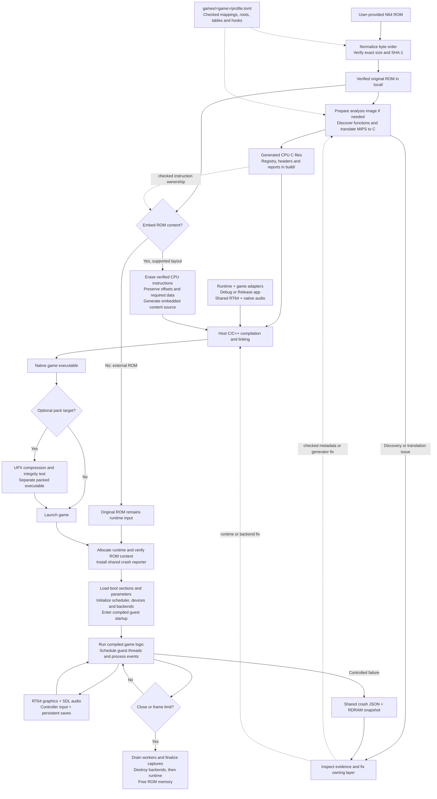
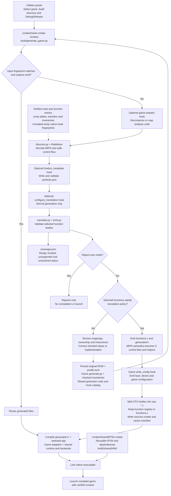
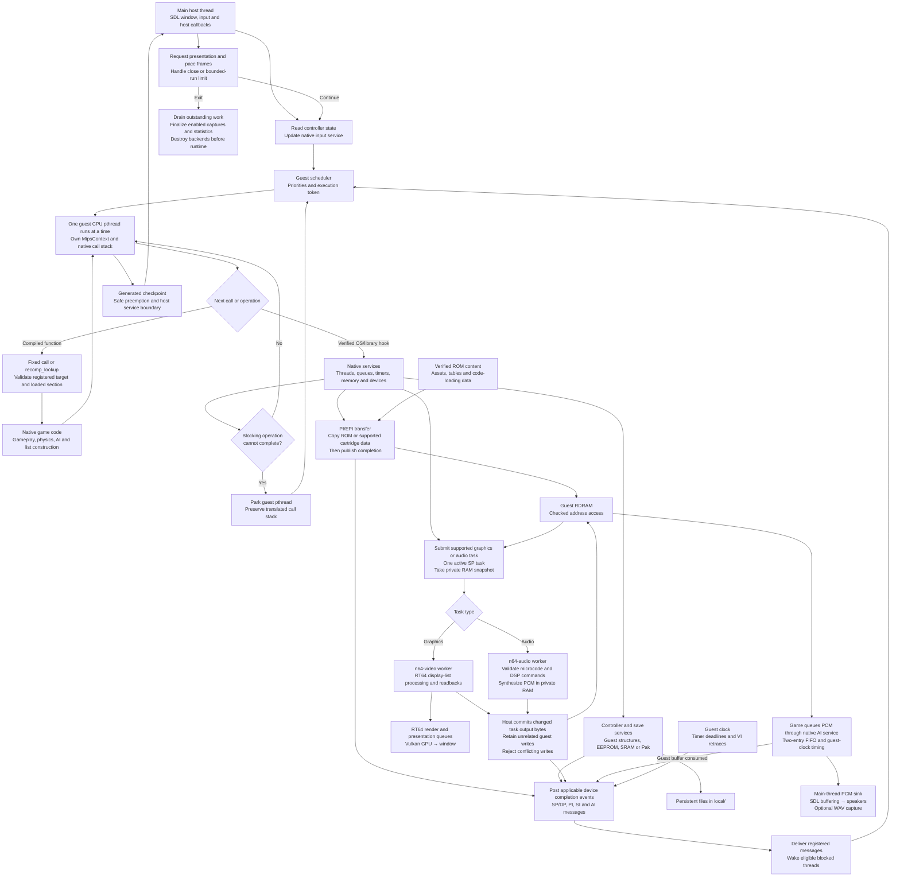
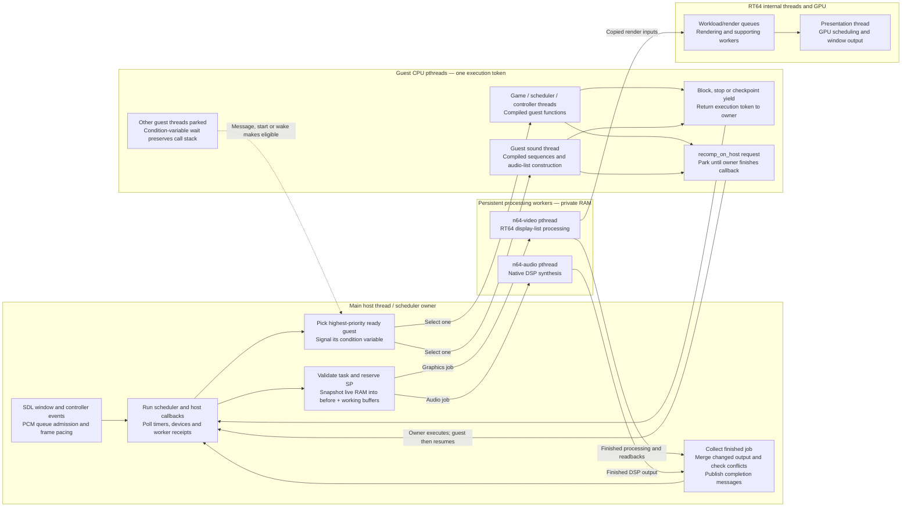
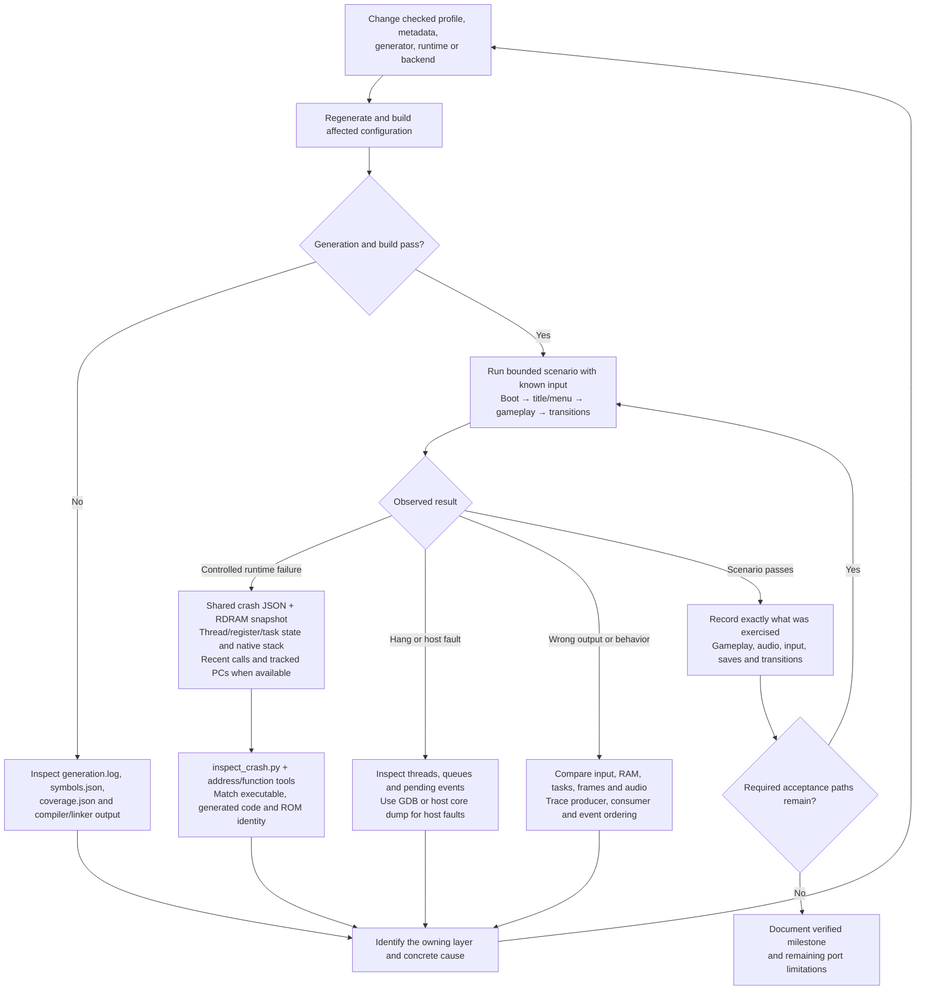

# Complete process flow

v64recomp translates a verified N64 ROM's CPU instructions into C during the
build. The host compiler produces native game code. During play, that code uses
shared native services for the N64 OS, devices, graphics and audio.

The graphs below show the whole lifecycle, followed by the generation pipeline,
runtime execution, threading and failure investigation. Solid arrows show control or data
flow; dotted arrows show configuration inputs or feedback.

## Whole lifecycle



Embedding and UPX packing are independent options. Embedding currently requires
the prepared analysis image to equal the original cartridge image; compressed
layouts that append decoded code are rejected. CPU stripping follows verified
instruction ownership and checked exceptions. Partial discovery can leave
undiscovered CPU code in the embedded content. See [ROM content packaging](rom-packaging.md).

## Generation and compilation



The translator preserves register widths, sign extension, branch delay slots,
guest addresses and floating-point behavior. Guest memory helpers and
`MipsContext` carry those semantics into the generated C. The host compiler then
optimizes and compiles it; CPU instruction decoding belongs to generation.

Known SDK/library bodies bind to native handlers after complete-body fingerprint
checks. Explicit game hooks handle verified custom boundaries. Unsupported
boundaries may be represented by functions that fail when reached, so successful
generation does not establish complete game support.

The driver caches generation against the ROM and generator inputs. CMake tracks
the generated source list, and unchanged generated content keeps its timestamps
to avoid unnecessary recompilation. Game-specific preparation and configuration
stay in `games/<game>/generate.py`.

## Runtime, devices and worker completion

Startup details vary by game. The common structure allocates guest RDRAM and the
compiled function registry, attaches verified ROM content through
`recomp_game_rom()`, installs boot mappings and parameters, initializes services
and backends, and enters the compiled startup code.



Graphics and audio workers can overlap guest CPU execution. Both use private
snapshots; worker output reaches guest RAM before the associated completion is
published. Graphics task completion follows display-list processing, readbacks
and copying of render inputs; it does not wait for GPU presentation. Guest AI
completion follows the modeled guest clock rather than the host sound device.

Custom paging, overlay loading, relocation and graphics extensions belong to the
game adapter. Section load state determines which compiled guest addresses are
callable. The scheduler still allows only one guest CPU thread to execute at a
time, even while processing workers are active.

## Thread ownership and concurrency

Each guest libultra thread has a real pthread, its own native stack and a
`MipsContext`. A scheduler mutex and condition variables transfer the execution
token between the owner and a selected guest thread. The runtime implements
guest priorities and FIFO order among equally ready threads. Linux thread
priorities do not determine libultra scheduling.



The main thread waits while a guest owns the token. A guest calling
`recomp_on_host()` parks while the main thread executes the requested callback,
then resumes at the same call site. Window/input handling, task submission and
PCM queue admission therefore retain their required host-thread ownership.

At generated checkpoints, guest interrupts being disabled suppresses checkpoint
yields. Otherwise the scheduler can preempt for ready higher-priority work;
the default interval of 64 checkpoints also returns control to the owner for
device polling. Forced yields can return earlier. Blocking queue calls yield
when their condition cannot be satisfied, independently of the normal polling
interval.

### A blocking receive and wakeup

```mermaid
sequenceDiagram
    participant H as Main host / scheduler
    participant A as Guest pthread A
    participant B as Guest pthread B
    participant W as Task worker
    H->>A: Grant execution token
    A->>A: osRecvMesg with blocking flag; queue empty
    A->>H: Mark WAIT_RECV, release token and park
    Note over A: Native stack and MipsContext remain intact
    H->>B: Grant token to next ready guest
    par Guest CPU work
        B->>B: Execute compiled game code
        B->>H: Block or reach checkpoint yield
    and Previously submitted worker job
        W->>W: Process private RAM snapshot
        W-->>H: Job result ready for collection
    end
    H->>H: Poll receipts and merge task output
    H->>H: Deliver registered completion message
    H->>H: Make A ready; apply guest priority ordering
    H->>A: Grant token when A is selected
    A->>A: Original receive completes; continue same call stack
```

This example uses a worker completion to satisfy the receive. Timer, VI, PI, SI
and AI events or another guest's queue send can also wake a receiver. A full
queue can similarly park a blocking sender until space becomes available.

### What can overlap

| Execution context | Work and concurrency |
| --- | --- |
| Main host thread | Runs SDL and owner callbacks while the active guest is parked; collects results and updates shared device state. |
| Selected guest pthread | Executes compiled CPU code with the execution token; other guest pthreads wait. |
| Guest sound pthread | Builds audio lists as ordinary guest CPU work and shares the same execution token. |
| `n64-audio` | Executes native DSP jobs against private RAM; can overlap guest CPU execution. |
| `n64-video` | Processes RT64 display lists against private RAM; can overlap guest CPU execution. |
| RT64 internal threads / GPU | Consume copied render inputs and handle rendering/presentation; can continue after graphics SP completion. |
| SDL audio device thread | Consumes queued host PCM independently; does not drive the guest AI completion clock. |

Each processing worker accepts one job at a time. The shared SP service allows
one active RSP task, so separate video and audio pthreads do not imply two
simultaneous active guest SP tasks. Rendering and presentation can continue after
the graphics SP task releases the processor for an audio task.

Snapshots and result commits occur under owner control while guest CPU execution
is parked. For each byte, the merge compares the original snapshot, worker result
and current guest RAM. Unchanged worker bytes are ignored. A changed worker byte
is committed if live RAM still contains the original byte or already equals the
result; a third, conflicting value triggers a controlled failure. The host posts
completion only after that merge.

Shutdown drains and joins workers before releasing their state, destroys
backends before the runtime, and wakes/joins parked guest threads before freeing
their storage. Worker failures preserve their originating native stack and are
reported through the owner thread. See [native threading](threading.md) for the
scheduler configuration and [audio](audio.md) for AI timing and SDL buffering.

## Investigation and validation loop



Persistent fixes belong in checked inputs or maintained source. Generated C is
recreated by the build. Static coverage, successful compilation and a booting
window establish different milestones; gameplay and save/load behavior require
their own exercised scenarios.

For CPU investigation, capture a representative Release scene with
`tools/profile_execution.py`, attribute cost by thread, then inspect native
stacks and generated functions. See [CPU profiling](profiling.md).

## Implementation map

| Stage | Main implementation and reference |
| --- | --- |
| ROM normalization and identity | [`tools/import_rom.py`](../tools/import_rom.py), [`tools/common.py`](../tools/common.py) |
| Game mappings and generation hooks | `games/<game>/profile.toml`, `games/<game>/generate.py`, [adding a ROM](adding-a-rom.md) |
| Generation orchestration | [`tools/generate_game.py`](../tools/generate_game.py), [`cmake/Game.cmake`](../cmake/Game.cmake) |
| Discovery and translation | [`tools/discover.py`](../tools/discover.py), [`tools/translate.py`](../tools/translate.py), [`tools/emit.py`](../tools/emit.py), [recompilation](recompilation.md) |
| Native hook matching | [`tools/symbols.json`](../tools/symbols.json), [native hooks](native-hooks.md) |
| Diagnostic SDK symbols and handler coverage | [`tools/inspect_sdk_symbols.py`](../tools/inspect_sdk_symbols.py), [SDK report interpretation](native-hooks.md#identifying-rom-routines-and-reviewing-handler-gaps) |
| Optional embedded content | [`tools/package_rom.py`](../tools/package_rom.py), [ROM content packaging](rom-packaging.md) |
| Optional executable compression | [`cmake/PackUPX.cmake`](../cmake/PackUPX.cmake) |
| Runtime entry and boot | `games/<game>/debug/app.c` or `release/app.c`, [`runtime/game.c`](../runtime/game.c), [`runtime/bootstrap.c`](../runtime/bootstrap.c) |
| Dispatch, guest memory and FPU | [`runtime/dispatch.c`](../runtime/dispatch.c), [`runtime/memory.c`](../runtime/memory.c), [`runtime/fpu.c`](../runtime/fpu.c) |
| Guest scheduling and OS | [`runtime/scheduler.c`](../runtime/scheduler.c), [`runtime/os.c`](../runtime/os.c), [threading](threading.md), [OS emulation](os-emulation.md) |
| Time, devices and task receipts | [`runtime/time.c`](../runtime/time.c), [`runtime/platform.c`](../runtime/platform.c), [`runtime/tasks.c`](../runtime/tasks.c), [`runtime/video.c`](../runtime/video.c) |
| Input and saves | [`runtime/io.c`](../runtime/io.c) |
| Graphics and textures | [`backends/rt64.cpp`](../backends/rt64.cpp), [`backends/textures.cpp`](../backends/textures.cpp), [textures](textures.md) |
| Audio synthesis and output | [`backends/audio.c`](../backends/audio.c), [`third_party/rsp-hle/README.md`](../third_party/rsp-hle/README.md), [audio](audio.md) |
| Shared renderer build | [`cmake/SharedRT64.cmake`](../cmake/SharedRT64.cmake) |
| Crash investigation | [`tools/inspect_crash.py`](../tools/inspect_crash.py), [debugging](debugging.md) |
