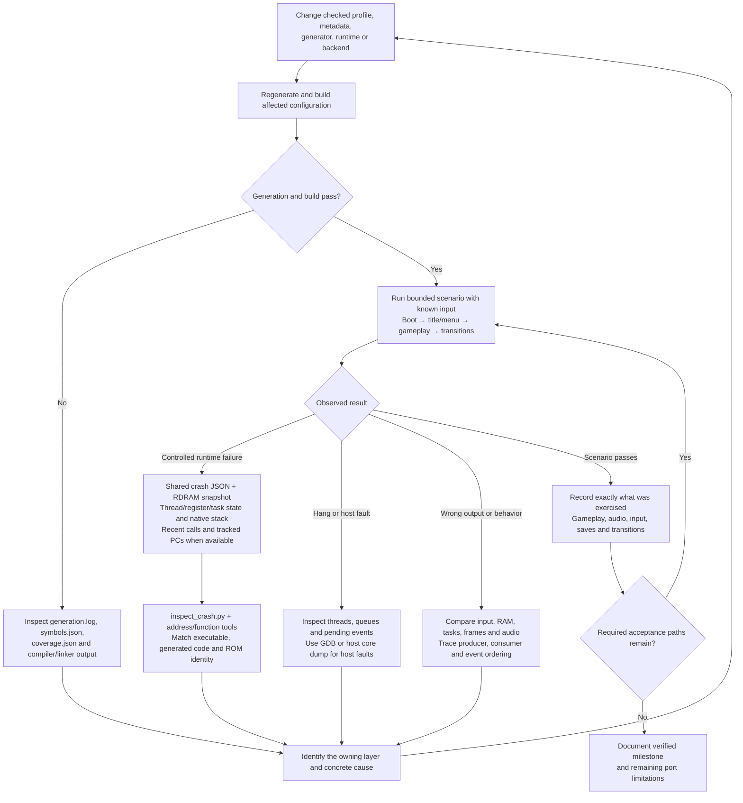

# Complete process flow

v64recomp translates a verified N64 ROM's CPU instructions into C during the
build. The host compiler produces native game code. During play, that code uses
shared native services for the N64 OS, devices, graphics and audio.

The graphs below show the whole lifecycle, followed by the generation pipeline,
runtime execution, threading and failure investigation. Solid arrows show control or data
flow; dotted arrows show configuration inputs or feedback.

## Whole lifecycle


Embedding and UPX packing are independent options. Embedding currently requires
the prepared analysis image to equal the original cartridge image; compressed
layouts that append decoded code are rejected. CPU stripping follows verified
instruction ownership and checked exceptions. Partial discovery can leave
undiscovered CPU code in the embedded content. See [ROM content packaging](rom-packaging.md).

## Generation and compilation


The translator preserves register widths, sign extension, branch delay slots,
guest addresses and floating-point behavior. Guest memory helpers and
`MipsContext` carry those semantics into the generated C. The host compiler then
optimizes and compiles it; CPU instruction decoding belongs to generation.

Known SDK/library bodies bind to native handlers after complete-body fingerprint
checks. Explicit game hooks handle verified custom boundaries. Unsupported
boundaries may be represented by functions that fail when reached, so successful
generation does not establish complete game support.

The driver caches generation against the ROM and generator inputs. CMake tracks
the generated source list, and unchanged generated content keeps its timestamps
to avoid unnecessary recompilation. Game-specific preparation and configuration
stay in `games/<game>/generate.py`.

## Runtime, devices and task completion

Startup details vary by game. The common structure allocates guest RDRAM and the
compiled function registry, attaches verified ROM content through
`recomp_game_rom()`, installs boot mappings and parameters, initializes services
and backends, and enters the compiled startup code.


Custom paging, overlay loading, relocation and graphics extensions belong to the
game adapter. Section load state determines which compiled guest addresses are
callable. The scheduler allows only one guest CPU thread to execute at a time.

## Thread ownership and concurrency

Each guest libultra thread has a stackful fiber, its own native C stack and a
`MipsContext`. Fibers and the scheduler share the main owner OS thread, switching
stacks locally when a guest blocks, yields or requests an owner callback. The
runtime implements guest priorities and FIFO order among equally ready threads.


The owner executes either its main stack or one guest fiber. A guest calling
`recomp_on_host()` switches to the main stack for the requested callback,
then resumes at the same call site. Window/input handling, task submission and
PCM queue admission therefore retain their required host-thread ownership.

At generated checkpoints, guest interrupts being disabled suppresses checkpoint
yields. Otherwise the scheduler can preempt for ready higher-priority work;
the default interval of 64 checkpoints also returns control to the owner for
device polling. Forced yields can return earlier. Blocking queue calls yield
when their condition cannot be satisfied, independently of the normal polling
interval.

### A blocking receive and wakeup

```mermaid
sequenceDiagram
    participant H as Main host / scheduler
    participant A as Guest fiber A
    participant B as Guest fiber B
    Note over H,B: All three contexts share the owner OS thread
    H->>A: Resume fiber
    A->>A: osRecvMesg with blocking flag; queue empty
    A->>H: Mark WAIT_RECV and yield fiber
    Note over A: Native stack and MipsContext remain intact
    H->>B: Resume next ready guest fiber
    B->>H: Submit task through recomp_on_host; park B
    H->>H: Process HLE using live RAM; queue completion
    H-->>B: Owner callback returns; resume B
    B->>H: Block or reach checkpoint yield
    H->>H: Poll queued task receipts
    H->>H: Deliver registered completion message
    H->>H: Make A ready; apply guest priority ordering
    H->>A: Resume fiber when A is selected
    A->>A: Original receive completes; continue same call stack
```

This example uses a queued HLE completion to satisfy the receive. Timer, VI, PI,
SI and AI events or another guest's queue send can also wake a receiver. A full
queue can similarly park a blocking sender until space becomes available.

### What can overlap


The SP service allows one active task. HLE writes live RAM before queuing
completion receipts; polling delivers SP before DP. Split lists without full
sync retire after SP. A whole-list HLE call cannot be suspended midway through
processing; a late yield polls its queued completion first.


## Investigation and validation loop



Persistent fixes belong in checked inputs or maintained source. Generated C is
recreated by the build. Static coverage, successful compilation and a booting
window establish different milestones; gameplay and save/load behavior require
their own exercised scenarios.

For CPU investigation, capture a representative Release scene with
`tools/profile_execution.py`, attribute cost by thread, then inspect native
stacks and generated functions. See [CPU profiling](profiling.md).

## Implementation map
