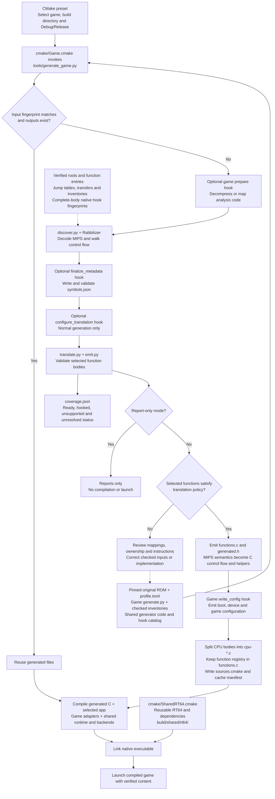
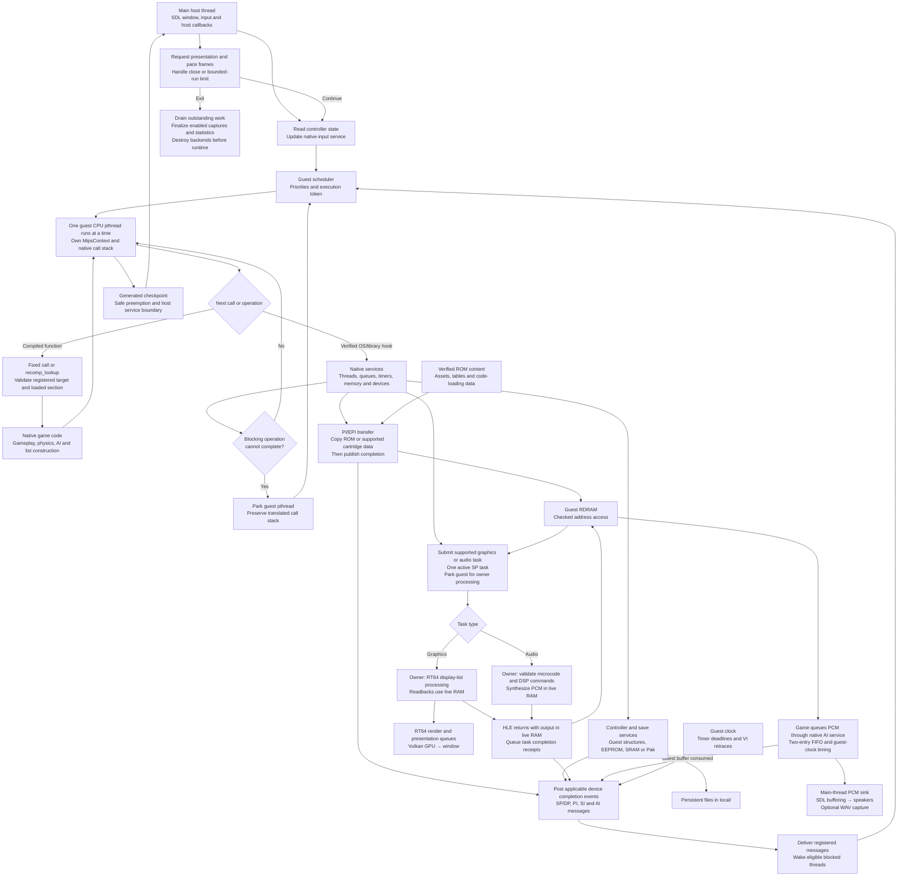
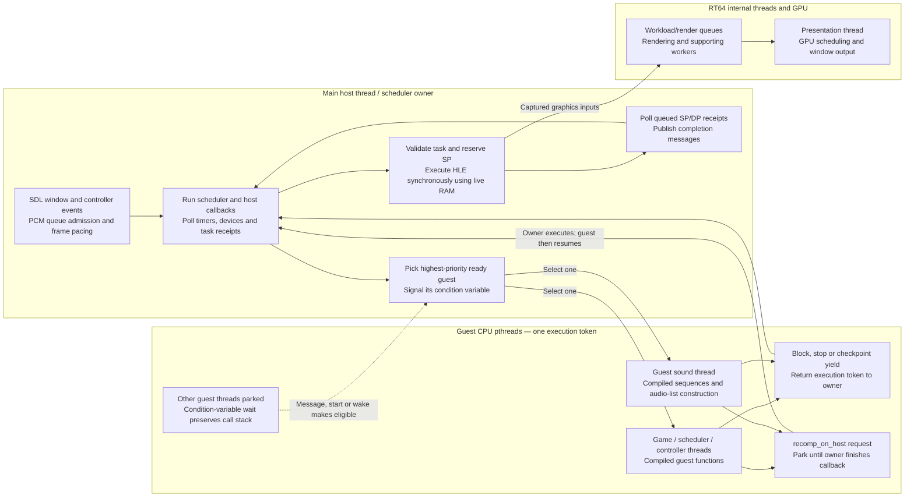
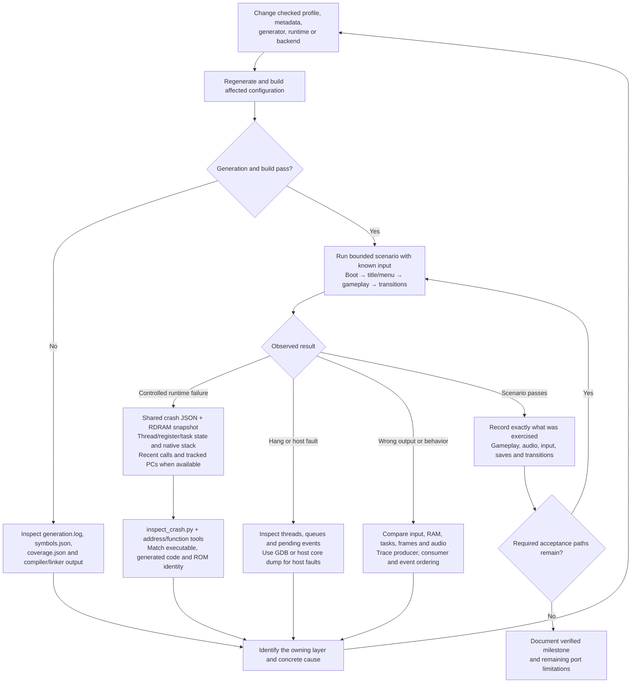

# Complete process flow

v64recomp translates a verified N64 ROM's CPU instructions into C during the
build. The host compiler produces native game code. During play, that code uses
shared native services for the N64 OS, devices, graphics and audio.

The graphs below show the whole lifecycle, followed by the generation pipeline,
runtime execution, threading and failure investigation. Solid arrows show control or data
flow; dotted arrows show configuration inputs or feedback.

## Whole lifecycle


Embedding and UPX packing are independent options. Embedding currently requires
the prepared analysis image to equal the original cartridge image; compressed
layouts that append decoded code are rejected. CPU stripping follows verified
instruction ownership and checked exceptions. Partial discovery can leave
undiscovered CPU code in the embedded content. See [ROM content packaging](rom-packaging.md).

## Generation and compilation



The translator preserves register widths, sign extension, branch delay slots,
guest addresses and floating-point behavior. Guest memory helpers and
`MipsContext` carry those semantics into the generated C. The host compiler then
optimizes and compiles it; CPU instruction decoding belongs to generation.

Known SDK/library bodies bind to native handlers after complete-body fingerprint
checks. Explicit game hooks handle verified custom boundaries. Unsupported
boundaries may be represented by functions that fail when reached, so successful
generation does not establish complete game support.

The driver caches generation against the ROM and generator inputs. CMake tracks
the generated source list, and unchanged generated content keeps its timestamps
to avoid unnecessary recompilation. Game-specific preparation and configuration
stay in `games/<game>/generate.py`.

## Runtime, devices and task completion

Startup details vary by game. The common structure allocates guest RDRAM and the
compiled function registry, attaches verified ROM content through
`recomp_game_rom()`, installs boot mappings and parameters, initializes services
and backends, and enters the compiled startup code.



Graphics HLE parsing, readbacks and audio DSP run synchronously on the owner
while guest CPU execution is parked. They use live RAM without full-memory
snapshots or merges. Graphics completion follows display-list processing,
readbacks and capturing render inputs; RT64 rendering and presentation remain
asynchronous. Guest AI completion follows the guest clock rather than the host
sound device. See [native threading](threading.md) for the RAM ownership contract.

Custom paging, overlay loading, relocation and graphics extensions belong to the
game adapter. Section load state determines which compiled guest addresses are
callable. The scheduler allows only one guest CPU thread to execute at a time.

## Thread ownership and concurrency

Each guest libultra thread has a real pthread, its own native stack and a
`MipsContext`. A scheduler mutex and condition variables transfer the execution
token between the owner and a selected guest thread. The runtime implements
guest priorities and FIFO order among equally ready threads. Linux thread
priorities do not determine libultra scheduling.



The main thread waits while a guest owns the token. A guest calling
`recomp_on_host()` parks while the main thread executes the requested callback,
then resumes at the same call site. Window/input handling, task submission and
PCM queue admission therefore retain their required host-thread ownership.

At generated checkpoints, guest interrupts being disabled suppresses checkpoint
yields. Otherwise the scheduler can preempt for ready higher-priority work;
the default interval of 64 checkpoints also returns control to the owner for
device polling. Forced yields can return earlier. Blocking queue calls yield
when their condition cannot be satisfied, independently of the normal polling
interval.

### A blocking receive and wakeup

```mermaid
sequenceDiagram
    participant H as Main host / scheduler
    participant A as Guest pthread A
    participant B as Guest pthread B
    H->>A: Grant execution token
    A->>A: osRecvMesg with blocking flag; queue empty
    A->>H: Mark WAIT_RECV, release token and park
    Note over A: Native stack and MipsContext remain intact
    H->>B: Grant token to next ready guest
    B->>H: Submit task through recomp_on_host; park B
    H->>H: Process HLE using live RAM; queue completion
    H-->>B: Owner callback returns; resume B
    B->>H: Block or reach checkpoint yield
    H->>H: Poll queued task receipts
    H->>H: Deliver registered completion message
    H->>H: Make A ready; apply guest priority ordering
    H->>A: Grant token when A is selected
    A->>A: Original receive completes; continue same call stack
```

This example uses a queued HLE completion to satisfy the receive. Timer, VI, PI,
SI and AI events or another guest's queue send can also wake a receiver. A full
queue can similarly park a blocking sender until space becomes available.

### What can overlap

| Execution context | Work and concurrency |
| --- | --- |
| Main host thread | Runs SDL, scheduling, graphics HLE and audio DSP while the guest is parked; waits while a guest owns the token. |
| One guest pthread | Executes translated game code; other guest CPU pthreads remain parked. |
| RT64 internal threads and GPU | Render and present captured workload data independently; can overlap guest CPU execution without accessing live guest RAM. |
| SDL audio device thread | Consumes queued host PCM independently; does not drive guest AI completion timing. |

The SP service allows one active task. HLE writes live RAM before queuing
completion receipts; polling delivers SP before DP. Split lists without full
sync retire after SP. A whole-list HLE call cannot be suspended midway through
processing; a late yield polls its queued completion first.

Shutdown drains RT64 queues, destroys backends before the runtime and joins guest
threads before releasing their storage. HLE failures occur directly on the owner
and use the shared crash reporter. See [native threading](threading.md) and
[audio](audio.md) for memory ownership and buffering.

## Investigation and validation loop



Persistent fixes belong in checked inputs or maintained source. Generated C is
recreated by the build. Static coverage, successful compilation and a booting
window establish different milestones; gameplay and save/load behavior require
their own exercised scenarios.

For CPU investigation, capture a representative Release scene with
`tools/profile_execution.py`, attribute cost by thread, then inspect native
stacks and generated functions. See [CPU profiling](profiling.md).

## Implementation map

| Stage | Main implementation and reference |
| --- | --- |
| ROM normalization and identity | [`tools/import_rom.py`](../tools/import_rom.py), [`tools/common.py`](../tools/common.py) |
| Game mappings and generation hooks | `games/<game>/profile.toml`, `games/<game>/generate.py`, [adding a ROM](adding-a-rom.md) |
| Generation orchestration | [`tools/generate_game.py`](../tools/generate_game.py), [`cmake/Game.cmake`](../cmake/Game.cmake) |
| Discovery and translation | [`tools/discover.py`](../tools/discover.py), [`tools/translate.py`](../tools/translate.py), [`tools/emit.py`](../tools/emit.py), [recompilation](recompilation.md) |
| Native hook matching | [`tools/symbols.json`](../tools/symbols.json), [native hooks](native-hooks.md) |
| Diagnostic SDK symbols and handler coverage | [`tools/inspect_sdk_symbols.py`](../tools/inspect_sdk_symbols.py), [SDK report interpretation](native-hooks.md#identifying-rom-routines-and-reviewing-handler-gaps) |
| Optional embedded content | [`tools/package_rom.py`](../tools/package_rom.py), [ROM content packaging](rom-packaging.md) |
| Optional executable compression | [`cmake/PackUPX.cmake`](../cmake/PackUPX.cmake) |
| Runtime entry and boot | `games/<game>/debug/app.c` or `release/app.c`, [`runtime/game.c`](../runtime/game.c), [`runtime/bootstrap.c`](../runtime/bootstrap.c) |
| Dispatch, guest memory and FPU | [`runtime/dispatch.c`](../runtime/dispatch.c), [`runtime/memory.c`](../runtime/memory.c), [`runtime/fpu.c`](../runtime/fpu.c) |
| Guest scheduling and OS | [`runtime/scheduler.c`](../runtime/scheduler.c), [`runtime/os.c`](../runtime/os.c), [threading](threading.md), [OS emulation](os-emulation.md) |
| Time, devices and task receipts | [`runtime/time.c`](../runtime/time.c), [`runtime/platform.c`](../runtime/platform.c), [`runtime/tasks.c`](../runtime/tasks.c), [`runtime/video.c`](../runtime/video.c) |
| Input and saves | [`runtime/io.c`](../runtime/io.c) |
| Graphics and textures | [`backends/rt64.cpp`](../backends/rt64.cpp), [`backends/textures.cpp`](../backends/textures.cpp), [textures](textures.md) |
| Audio synthesis and output | [`backends/audio.c`](../backends/audio.c), [`third_party/rsp-hle/README.md`](../third_party/rsp-hle/README.md), [audio](audio.md) |
| Shared renderer build | [`cmake/SharedRT64.cmake`](../cmake/SharedRT64.cmake) |
| Crash investigation | [`tools/inspect_crash.py`](../tools/inspect_crash.py), [debugging](debugging.md) |
