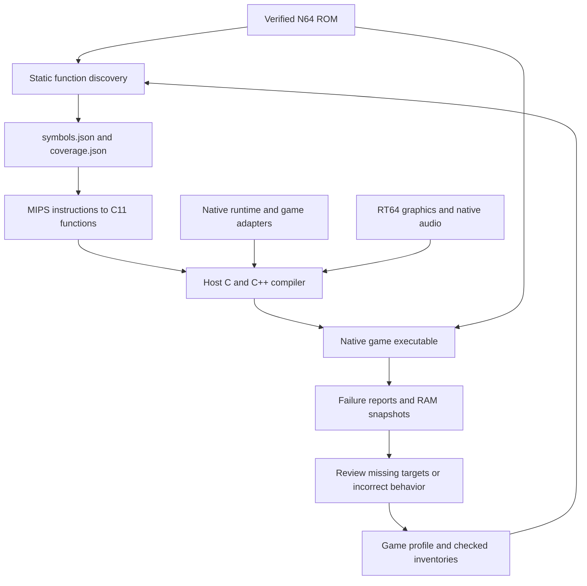

# How recompilation works

The build starts with a verified game ROM. Rabbitizer decodes its MIPS CPU
instructions, the translation tools emit C11 functions, and the host compiler
turns those functions into a native executable. The original game still controls
its logic and reads its assets from the ROM. Shared native services implement
the N64 OS and hardware interactions required by each game.

See the [complete process flow](process-flow.md) for detailed graphs of the build,
runtime services, graphics/audio HLE, packaging and investigation loop.



### 1. Verify the ROM and describe its memory layout

Import accepts the common big-endian, byte-swapped and word-swapped N64 ROM
formats, normalizes the bytes, and verifies the expected size and SHA-1. Profiles
target exact ROM revisions; addresses and instruction fingerprints depend on
those bytes.

A ROM does not provide the ELF section and symbol information needed by the
translator. Each game's TOML profile supplies the relevant mappings from ROM
offsets to N64 virtual addresses, along with startup parameters, known function
roots and any special loading behavior. For example, Duke's profile maps its
initial `.main` region from ROM offset `0x1000` to guest address `0x8004B400`.
Such a mapped region can contain both code and data; mapping it does not classify
every byte as an instruction.

Builds do not require the original game's C source or a matching ELF/map. SM64's
complete inventory was cross-checked against a matching ELF/map during
development, but its build reads the stored inventory and ROM.

### 2. Discover functions without running the game

`tools/discover.py` walks instruction control flow from the ROM entry point,
profile roots and checked function entries. It follows direct calls, discovers
their targets, and explores both possible branch paths unless the instruction
itself proves one impossible. N64 branch delay slots are included in that
analysis. This stage does not need gameplay or a recorded execution trace.

Indirect transfers need additional information. A direct `jal` instruction
encodes its destination, while `jalr` takes a destination from a register.
Computed local jumps can select a target from a switch table. Profiles can supply
checked targets and jump tables, and registered indirect calls can resolve
against the compiled function registry at runtime.

Handwritten assembly can materialize a local return address before jumping or
conditionally branching into a shared helper. `discovery.tail_continuations`
binds the transfer's `pc` and `expected_word` to a `resume_pc` in the caller.
After the helper returns, generated code verifies RA and resumes that label.
Conditional transfers apply this only on the taken path; branch-likely delay
slots remain annulled on the untaken path. Checked `fallthroughs` describe the
equivalent continuation when execution falls into a separate helper entry.

Files such as [Duke's startup-entries.json](../games/duke-us/startup-entries.json)
provide checked function starts for partial conversions:

| Field | Purpose |
| --- | --- |
| `format_version` | Identifies the inventory format. |
| `rom_sha1` | Binds the inventory to the exact normalized ROM. |
| `complete` | `false` identifies a partial function-entry inventory. |
| `entries[].vram` | Gives the original N64 address of a function entry. |
| `entries[].origin` | Records how the entry was identified: `direct-jal`, `stack-prologue` or `checked-root`. |
| `entries[].sha256` | Verifies the first 16 bytes at that address before using it. |

These entries seed discovery, including functions that may only be reached as
callbacks. The JSON supplies function starts; the profile supplies memory
regions. The entry fingerprint verifies the instruction prefix, rather than
claiming to describe the function's complete body or size.

Static discovery alone cannot guarantee every function has been found. Unused
code, function pointers, computed addresses and data that decodes as valid MIPS
instructions can leave ambiguities. Discovery reports unresolved transfers,
conflicting instruction ownership and unvisited ranges for review.

[Ocarina of Time's callback analyzer](../games/oot-us-v12/debug/analyze_callbacks.py)
uses shared pointer and address-materialization scans to propose missing roots.
Proposals retain their source sites and fingerprints for review, followed by
another discovery pass to validate ownership and indirect transfers.

A complete inventory, such as
[SM64's code-inventory.json](../games/sm64-us/code-inventory.json), additionally
classifies every byte of the configured regions as CPU code, data, native OS
code or RSP code. The tools validate contiguous range coverage and fingerprints,
and retain instructions in CPU code ranges even when the control-flow walk did
not visit them. Constructing that inventory can be done through static analysis
and review without playing the game. A complete inventory still needs separate
runtime validation; neither static coverage nor a gameplay trace proves that
every game scenario behaves correctly.

### 3. Translate MIPS semantics into C

`tools/translate.py` checks discovered functions and writes a coverage report
before emitting `functions.c` and `generated.h`. Unsupported instructions or
unresolved targets in selected ordinary functions prevent generation. Explicit
unsupported boundaries can be emitted as functions that fail if called; partial
conversions report those boundaries rather than implying full game support.

The generated C represents guest registers through `MipsContext`. Arithmetic
helpers preserve MIPS widths and sign extension, memory operations go through
guest address helpers, and branches become C control flow with the required
delay-slot behavior. For example, the instruction `addiu v0, v0, 1` is lowered
to an operation equivalent to:

```c
mips_set(ctx, 2, mips_s32((uint32_t)ctx->gpr[2] + (uint32_t)1));
```

This performs a wrapping 32-bit addition and sign-extends the result into the
64-bit guest register. The host compiler then produces machine code for it.
The game executes those compiled functions; CPU instructions are decoded during
generation rather than fetched and interpreted during play.

See [MIPS code expansion and native efficiency](code-expansion.md) for measured
source/native size ratios, a real MIPS → C → x86-64 example and the optimizations
available to the host compiler.

Guest addresses remain N64 addresses. The runtime maps them into its RDRAM
buffer, handles supported address aliases and game-specific mappings, and checks
memory access ranges. Floating-point helpers preserve the required guest
rounding and register behavior. See [floating point](fpu.md) for details.

### 4. Connect the compiled game to native services

Generated functions are registered by their original guest addresses.
`recomp_lookup` resolves calls to a registered function in a loaded section;
unknown, unloaded or ambiguous destinations fail explicitly. Verified native
hooks with unique entries can be called directly while retaining section checks.
Fixed generated calls and checked indirect targets also use precomputed registry
entries where the address is unique. Remaining dynamic calls use an address hash
index built once during runtime initialization, with expected constant-time
lookup. Addresses shared by overlays still check their loaded-section candidates
on each call. The index retains live registry references so Debug replacements,
address remapping and pager preparation continue to apply.

The [shared native hook catalog](native-hooks.md) recognizes known OS and
library routines by their complete ROM-body fingerprints. These bind to native
implementations for threads, message queues, timers, devices, saves and selected
memory/string operations. Unrecognized ordinary routines keep their translated
CPU code. Game-specific adapters handle custom behavior such as virtual-memory
paging or graphics extensions.

Guest threads use native pthreads with a scheduler-controlled execution token.
Blocking OS operations park a thread and resume another according to guest
priorities. One guest CPU thread runs at a time, preserving interrupt critical
sections. Generated checkpoints provide safe scheduling and event boundaries.
Native services preserve guest memory structures, calling conventions and
completion events expected by the translated game.
See [native threading](threading.md) for scheduling and HLE ownership.

Graphics tasks pass to RT64 for Vulkan rendering. The translated game's audio
code builds command lists; the shared native audio backend executes supported,
verified ABI1 and Zelda NEAD tasks to produce PCM in guest RAM. The native AI service supplies
buffer timing and completion events, and SDL plays the samples. Audio synthesis,
graphics display-list parsing and presentation preparation run on the main
owner thread with the guest parked. They use live RAM and queue SP/DP completion
after output writes. RT64's internal rendering queues and SDL playback remain
asynchronous. SDL window and input operations stay on the main thread. These task
backends implement supported graphics/audio behavior rather than translating
RSP microcode through the CPU translator. See [audio](audio.md).

### 5. Record gaps and investigate runtime failures

Discovery, translation and controlled runtime failures produce different
artifacts:

| Artifact | What it records |
| --- | --- |
| `symbols.json` | Mapped sections, discovered functions, instruction addresses, discovery errors and unvisited ranges. |
| `coverage.json` | Function translation status, unsupported instructions/targets, metadata issues and inventory coverage. |
| Crash JSON | The controlled runtime failure and diagnostic state, with fields supplied by the game's app. |
| RDRAM snapshot | Guest memory saved alongside a controlled runtime failure. |

Controlled runtime failures write JSON and word-swapped RDRAM snapshots. See
[the build and crash workflow](../README.md). Host faults outside the runtime's
checks require GDB or a host core dump.
