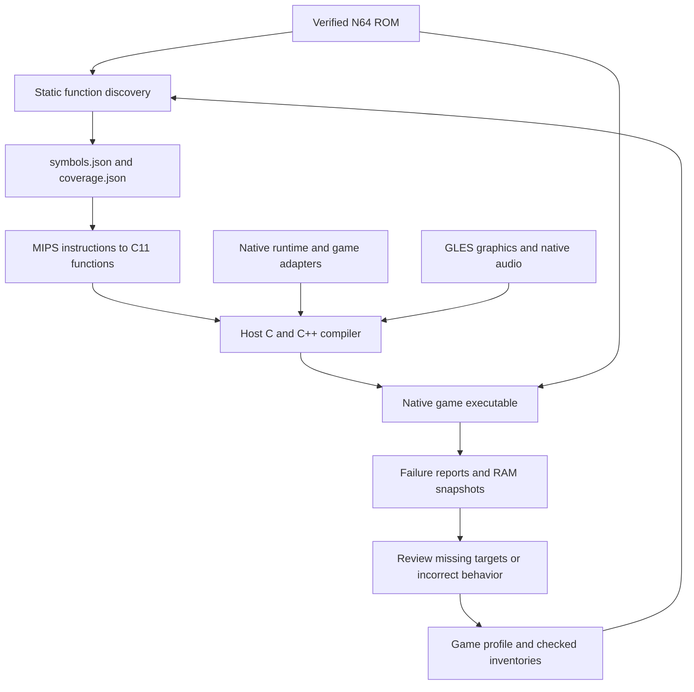

# How recompilation works

The build starts with a verified game ROM. Rabbitizer decodes its MIPS CPU
instructions, the translation tools emit C11 functions, and the host compiler
turns those functions into a native executable. The original game still controls
its logic and reads its assets from the ROM. Shared native services implement
the N64 OS and hardware interactions required by each game.

See the [complete process flow](process-flow.md) for detailed graphs of the build,
runtime services, graphics and RSP audio, packaging and investigation loop.



### 1. Verify the ROM and describe its memory layout

Import accepts the common big-endian, byte-swapped and word-swapped N64 ROM
formats, normalizes the bytes, and verifies the expected size and SHA-1. Profiles
target exact ROM revisions; addresses and instruction fingerprints depend on
those bytes.

A ROM does not provide the ELF section and symbol information needed by the
translator. Each game's TOML profile supplies the relevant mappings from ROM
offsets to N64 virtual addresses, along with startup parameters, known function
roots and any special loading behavior. For example, Duke's profile maps its
initial `.main` region from ROM offset `0x1000` to guest address `0x8004B400`.
Such a mapped region can contain both code and data; mapping it does not classify
every byte as an instruction.

Builds do not require the original game's C source or a matching ELF/map. SM64's
complete inventory was cross-checked against a matching ELF/map during
development, but its build reads the stored inventory and ROM.

### 2. Discover functions without running the game

`tools/discover.py` walks instruction control flow from the ROM entry point,
profile roots and checked function entries. It follows direct calls, discovers
their targets, and explores both possible branch paths unless the instruction
itself proves one impossible. N64 branch delay slots are included in that
analysis. This stage does not need gameplay or a recorded execution trace.

For partial inventories with registered indirect calls, the scanner also follows
a masked selector through a shift, table address, word load and `jalr`. It uses
the mask to bound the rows, checks the ROM mapping and instruction ownership,
and follows newly discovered entries through the same discovery queue. Because
guest code can replace a pointer in RAM, these tables add known destinations
while keeping dynamic dispatch active. A bounded local `jr` switch contributes
case labels to the owning function. Debug can record the targets seen in play.
[Comparing transfer coverage](debugging.md#finding-missing-indirect-targets-across-games)

For partial inventories, discovery recognizes a local switch when an unsigned
`sltiu` bound feeds a `beq` to the default case, the guarded path scales the
same index by four in or immediately after the delay slot, and `lui/addu/lw` loads the destination for `jr`. Discovery
checks register flow and the mapped extent of the table, records its SHA-256,
and follows the case blocks and their calls. An explicit profile transfer takes
precedence. A branch into the middle of an inferred dispatch requires review.

VR4300 branch-and-link instructions write `ra = PC + 8` even when untaken.
Discovery therefore treats `BLTZAL $zero` as address materialization, without
following its unreachable destination into possible inline data. Translation
evaluates the condition before updating `ra` and preserves likely delay-slot
annulment.

Word arithmetic right shifts use SSE2 when `USE_INTRISICS=1`; the fallback uses
unsigned subtraction to extend the sign. Both paths truncate to 32 bits before
shifting and mask variable counts to five bits. This avoids an MSVC optimization
failure in the former conditional sign-fill implementation, which could retain
a packed word's sign after `SLL 16; SRA 16`.

With `USE_INTRISICS=1`, MSVC x64 uses `__emul`/`__emulu` for word
multiplication and `_mul128`/`_umul128` for doubleword multiplication. Compilers
with `__int128` use native 128-bit products for doublewords. Word operations
still ignore the upper input halves and sign-extend each 32-bit HI/LO result;
doubleword operations retain all 128 product bits. `USE_INTRISICS=0` keeps the
portable implementations, including the four-limb doubleword product.

Signed `ADD`/`ADDI`, `DADD`, and `SUB` use compiler overflow builtins with
GCC/Clang when `USE_INTRISICS=1`. MSVC x64 uses `_add_overflow_i32`,
`_add_overflow_i64`, and `_sub_overflow_i32` from
[Visual Studio 2022 17.7](https://learn.microsoft.com/visualstudio/releases/2022/release-notes-v17.7)
onwards; older MSVC versions and `USE_INTRISICS=0` retain the unsigned
arithmetic/sign-bit fallback. Overflow still stops through `recomp_fail`
before the destination register is written. These intrinsics test signed
overflow, including cases where the unsigned carry/borrow flag differs.

Indirect transfers need additional information. A direct `jal` instruction
encodes its destination, while `jalr` takes a destination from a register.
Computed local jumps can select a target from a switch table. Profiles can supply
checked targets and jump tables, and registered indirect calls can resolve
against the compiled function registry at runtime.

Discovery recognizes a counted MIPS record search when the loop initializes a
ROM table pointer and counter, compares each record's ID, advances by a fixed
stride, and calls a fixed field only on a match. Look for `counted-record-call`
in a function's `entry_sources` to see the call site and hashed table span.
For a missing target at an ordinary generated indirect call, the live-repair
request records the caller's guest PC and section in both build configurations.

For a function table stored as records, set `count` to the number of records,
`stride` to their size in bytes, and `field_offset` to the callback's byte
offset within each record. The SHA-256 covers all records, including their
non-pointer fields. Optional `indices` select record numbers. Set
`nullable = true` when the consumer checks for a null method before calling it.
When several arrays or runtime-installed callbacks feed one call, `partial = true`
registers the reviewed rows of each array. This requires registered indirect
calls, a checked entry inventory, and a matching JALR instruction. The call can
still reach other entries registered for the game.
A contiguous pointer table uses the defaults of four-byte stride and offset zero.

Callback discovery follows a literal function pointer through a straight-line
wrapper when the called function invokes the forwarded argument. It recognizes
o32 stack saves, including a save in a call delay slot, and verifies that an
intervening leaf call preserves the saved word. For deferred callbacks it also
matches an argument stored at a fixed guest RAM address to a `jalr` through
that same word. At a branch join, every incoming load must agree on the slot.
The generated symbol metadata records the caller, forwarding or store site,
and indirect call so the inference can be checked against the ROM.

Discovery also recognizes adjacent calls that initialize and consume the same
object. It follows a literal stored by the initializer when the consumer passes
that field to a checked callback parameter. The initializer must return with
the full pointer intact. The evidence records both calls and the field offset
in the producer’s overlay.

A conditional branch can also separate construction of a function pointer from
the call that receives it. Discovery tracks the untaken path through an
ordinary branch's delay slot. For a branch-likely instruction it restores the
register and outgoing stack values from before the annulled slot. Direct branch
targets, checked switch targets and continuation entries discard local constants.

A partial port using registered indirect calls can declare a known callback
argument in `discovery.callback_parameters`. Give the callee's `section`,
`vram`, complete body `size` and `sha256`, the o32 argument `register` (4–7),
and a reviewed consumer's `call_pc` and `expected_word` in the same section.
Document how the argument reaches that consumer. Discovery checks the ROM body
and JALR instruction, then follows literal callback arguments in translated
callers. Each inferred entry records its producer and indirect call site.

Partial ports may also declare `discovery.registered_direct_calls`, with `pc`,
`expected_word`, `target`, and an optional source `section`. Each site must match
an actual `JAL` and its encoded destination. This permits a caller's independent
paths to run before every separately loaded module is converted. The taken call
still uses the compiled registry and its loaded-section checks; an unavailable
target fails at that call. These declarations do not seed speculative entries or
authorize native replacements, and complete code inventories cannot use them.
`coverage.json` lists the retained sites separately.

Handwritten assembly can materialize a local return address before jumping or
conditionally branching into a shared helper. `discovery.tail_continuations`
binds the transfer's `pc` and `expected_word` to a `resume_pc` in the caller.
After the helper returns, generated code verifies RA and resumes that label.
Conditional transfers apply this only on the taken path; branch-likely delay
slots remain annulled on the untaken path. Checked `fallthroughs` describe the
equivalent continuation when execution falls into a separate helper entry.

Files such as [Duke's startup-entries.json](../games/duke-us/startup-entries.json)
provide checked function starts for partial conversions:

| Field | Purpose |
| --- | --- |
| `format_version` | Identifies the inventory format. |
| `rom_sha1` | Binds the inventory to the exact normalized ROM. |
| `complete` | `false` identifies a partial function-entry inventory. |
| `entries[].vram` | Gives the original N64 address of a function entry. |
| `entries[].origin` | Records how the entry was identified: `direct-jal`, `stack-prologue` or `checked-root`. |
| `entries[].sha256` | Verifies the first 16 bytes at that address before using it. |

These entries seed discovery, including functions that may only be reached as
callbacks. The JSON supplies function starts; the profile supplies memory
regions. The entry fingerprint verifies the instruction prefix, rather than
claiming to describe the function's complete body or size.

Static discovery alone cannot guarantee every function has been found. Unused
code, function pointers, computed addresses and data that decodes as valid MIPS
instructions can leave ambiguities. Discovery reports unresolved transfers,
conflicting instruction ownership and unvisited ranges for review.

[The shared callback inspector](../tools/analysis/inspect_callbacks.py) and
[function candidate inspector](../tools/analysis/inspect_function_candidates.py)
use pointer and address-materialization scans to propose missing roots.
Proposals retain their source sites and fingerprints for review, followed by
another discovery pass to validate ownership and indirect transfers.

A complete inventory, such as
[SM64's code-inventory.json](../games/sm64-us/code-inventory.json), additionally
classifies every byte of the configured regions as CPU code, data, native OS
code or RSP code. The tools validate contiguous range coverage and fingerprints,
and retain instructions in CPU code ranges even when the control-flow walk did
not visit them. Constructing that inventory can be done through static analysis
and review without playing the game. A complete inventory still needs separate
runtime validation; neither static coverage nor a gameplay trace proves that
every game scenario behaves correctly.

### 3. Translate MIPS semantics into C

`tools/translate.py` checks discovered functions and writes a coverage report
before emitting `functions.c` and `generated.h`. Unsupported instructions or
unresolved targets in selected ordinary functions prevent generation. Explicit
unsupported boundaries can be emitted as functions that fail if called; partial
conversions report those boundaries rather than implying full game support.

The generated C caches guest registers in local variables using MIPS o32
assembly names (`at`, `v0`/`v1`, `a0`–`a3`, `t0`–`t9`, `s0`–`s7`, `k0`/`k1`,
`gp`, `sp`, `fp`, `ra`). Register 30 uses `fp`, also known as `s8`. These locals
synchronize with the numbered `MipsContext.gpr` array at runtime boundaries;
reads of `$zero` remain constant zero and writes are discarded. Arithmetic
helpers preserve MIPS widths and sign extension, memory operations go through
guest address helpers, and branches become C control flow with the required
delay-slot behavior. For example, the instruction `addiu v0, v0, 1` is lowered
to an operation equivalent to:

```c
v0 = mips_s32((uint32_t)v0 + (uint32_t)1);
```

This performs a wrapping 32-bit addition and sign-extends the result into the
64-bit guest register. The host compiler then produces machine code for it.
The game executes those compiled functions; CPU instructions are decoded during
generation rather than fetched and interpreted during play.

See [MIPS code expansion and native efficiency](code-expansion.md) for measured
source/native size ratios, a real MIPS → C → x86-64 example and the optimizations
available to the host compiler.

Guest addresses remain N64 addresses. The runtime maps them into its RDRAM
buffer, handles supported address aliases and game-specific mappings, and checks
memory access ranges. Floating-point helpers preserve the required guest
rounding and register behavior. See [floating point](fpu.md) for details.

On little-endian Release builds, the emitter shares direct-RAM checks across
consecutive loads/stores with stable base registers. It checks the complete
access span for each base before using physical RDRAM offsets, retaining the
original access order, word-swapped layout and overlapping-buffer behavior.
If any span leaves the first 8 MiB of KSEG0/KSEG1, the whole group uses its
original helpers, including mapped-address and device callbacks. This retains
the existing Release assumption of aligned, valid guest RAM accesses; Debug
keeps the checked helpers and instruction tracking for every access.

Groups contain 4–16 consecutive memory instructions, with at least two accesses
per base on average and a maximum 256-byte span per base. Calls, arithmetic,
branches, delay slots, relocated operands, checked continuations, instruction
gaps and interior entry points split groups. A group cannot modify any of its
base registers. Live-resume bodies keep their original helpers because every
instruction can be an entry point. These limits bound duplicated fallback code
and avoid carrying an address proof across changes to registers or mappings.
See [GoldenEye timing results](profiling.md#goldeneye-address-specialization-timing-2026-11-04).

### 4. Connect the compiled game to native services

Generated functions are registered by their original guest addresses.
`recomp_lookup` resolves calls to a registered function in a loaded section;
unknown, unloaded or ambiguous destinations fail explicitly. Verified native
hooks with unique entries can be called directly while retaining section checks.
Fixed generated calls and checked indirect targets use a direct C symbol in
Release where the address is unique and no canonical-address mapper is active.
Loaded-section validation and pager preparation still precede the call. This
avoids the extra dispatch-wrapper call and registry function-pointer call on
that path. Debug and mapped-address calls retain shared dispatch using the
precomputed registry entry. Remaining dynamic calls use an address hash
index built once during runtime initialization, with expected constant-time
lookup. Addresses shared by overlays still check their loaded-section candidates
on each call. The index retains live registry references so Debug replacements,
address remapping and pager preparation continue to apply.

The [shared native hook catalog](native-hooks.md) recognizes known OS and
library routines by their complete ROM-body fingerprints. These bind to native
implementations for threads, message queues, timers, devices, saves and selected
memory/string operations. Unrecognized ordinary routines keep their translated
CPU code. Game-specific adapters handle custom behavior such as virtual-memory
paging or graphics extensions.

Guest threads use native pthreads with a scheduler-controlled execution token.
Blocking OS operations park a thread and resume another according to guest
priorities. One guest CPU thread runs at a time, preserving interrupt critical
sections. Generated checkpoints provide safe scheduling and event boundaries.
Native services preserve guest memory structures, calling conventions and
completion events expected by the translated game.
See [native threading](threading.md) for scheduling and HLE ownership.

GLES runs verified graphics microcode on the guest owner and hands its RDP
output to a render thread. The owner signals SP completion after the handoff
and publishes synchronized framebuffer writes before DP completion.
[Graphics RSP and game coverage](armv8-gles2.md).

The translated game prepares its audio synthesis tasks. The runtime executes
the recompiled audio program on live RAM. The native AI service supplies buffer
timing and completion events, and SDL plays the samples. [Audio](audio.md).

### 5. Record gaps and investigate runtime failures

Discovery, translation and controlled runtime failures produce different
artifacts:

| Artifact | What it records |
| --- | --- |
| `symbols.json` | Mapped sections, discovered functions, instruction addresses, discovery errors and unvisited ranges. |
| `coverage.json` | Function translation status, unsupported instructions/targets, metadata issues and inventory coverage. |
| Crash JSON | The controlled runtime failure and diagnostic state, with fields supplied by the game's app. |
| RDRAM snapshot | Guest memory saved alongside a controlled runtime failure. |

Controlled runtime failures write JSON and word-swapped RDRAM snapshots. See
[the build and crash workflow](../README.md). Host faults outside the runtime's
checks require GDB or a host core dump.

A checked function entry may coincide with another function's terminal `jr ra`
delay slot. Both paths execute that word; the separately called entry then
continues into its own body. Discovery and metadata validation permit exactly
this one shared word, with the preceding `jr ra` checked against the ROM. Other
body overlaps remain errors. Turok US v1.2 uses this arrangement at `0x80000c78`
in its original RNC2 unpacker.
